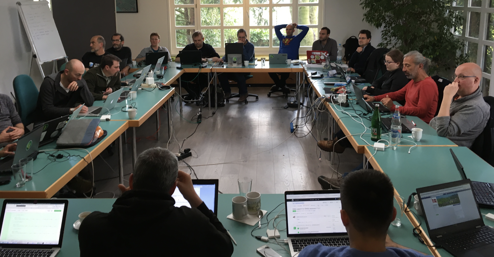

&nbsp;

QGIS Developers and Community Members working on QGIS at our recent meet up in Essen, German,

Dear Voting members (and interested QGIS community members out there)

<strong>This is an open letter that was emailed to all QGIS voting members today</strong>

Just a quick note from me to thank you for participating in our &#8216;virtual AGM&#8217; &#8211; I know it is a bit of an unusual system but it suits our geographically diverse nature well and we seem to have pretty good participation in the process (though I really encourage those voting members who did not participate to do so next time!).

I have done a bunch of updates on our governance section of the web site so you can find the AGM minutes, annual report, budget etc. all on the site, and I (or whoever is chair) will post them there in future years too so everything is in one place and easy to access. Here with the relevant links:

<ul>
<li><a href="http://www.qgis.org/en/site/getinvolved/governance/annual_reports/index.html">Annual Reports</a></li>
<li><a href="http://www.qgis.org/en/site/getinvolved/governance/annual_general_meetings/index.html">Annual General Meetings</a></li>
<li><a href="http://www.qgis.org/en/site/getinvolved/governance/finance/index.html">Budgets &amp; Financial Reports</a></li>
</ul>

Since we have approved a new version of the statutes, I have replaced the old PSC page on the web site with the new charter:

<a href="http://www.qgis.org/en/site/getinvolved/governance/psc.html">http://www.qgis.org/en/site/getinvolved/governance/psc.html</a>

Thank you all for the many useful hints, tips and suggestions I regularly receive on how to make things smoother within the project (keep them coming!) &#8211; hopefully we will get into a steady routine with this governance now. We have been going through a lot of ramp up trying to get templates, processes, etc in place as we switch over to QGIS.ORG legal entity etc. We appreciate your patience while we figure things out &#8211; and a very big thank you to Andreas Neumann and Anita Graser who have pitched in with a lot of administrative work behind the scenes to help get the QGIS legal entity in place!

What&#8217;s next? I will be starting the nomination process for 4 new community voting members, soon (one to match each of the incoming country user groups for Norway, Sweden, South Africa and France). At the end of that process we will have 31 voting members.

Soon QGIS.ORG will be in the Swiss Trade Registry, which means we can be VAT registered, can take ownership of the QGIS.ORG trademark (which is currently held in proxy for us) and of course present ourselves as a well governed project, hopefully attractive to large funders who recognize the global good a project like QGIS does!

Regards

<b>Tim Sutton</b>

QGIS Project Steering Committee Chair

<a href="mailto:tim@qgis.org" target="_blank" rel="noopener noreferrer">tim@qgis.org</a>

