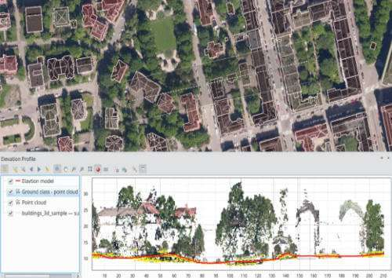

<pre>Lutra Consulting, North Road and Hobu are collaborating in a new crowd-funding campaign to extend these capabilities in future QGIS releases!</pre>

<figure></figure>

Highlights of the planned improvements include: 

<ul>
<li><strong>Point Clouds</strong> Creating point cloud processing tools for transformation, management and analysis of point clouds. Ensuring that extremely large (terabyte size) datasets can be handled well for both display and analysis.</li>

<li><strong>Elevation Profiles</strong> Support embedding customisable elevation profiles into print layouts and atlases, and allow exporting elevation profiles to CSV and DXF.</li>

<li><strong>3D Maps</strong> Faster 3D maps for large scenes, an improved 3D measurement tool and further improvements to 3D scene navigation.</li>
</ul>

Your financial support is vital to make these improvements possible! Visit the <a href="https://www.lutraconsulting.co.uk/crowdfunding/pointcloud-processing-qgis/">crowd funding page</a> for additional information on what is included in the effort and how you can financially contribute.

