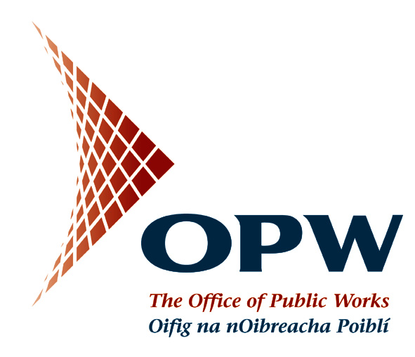
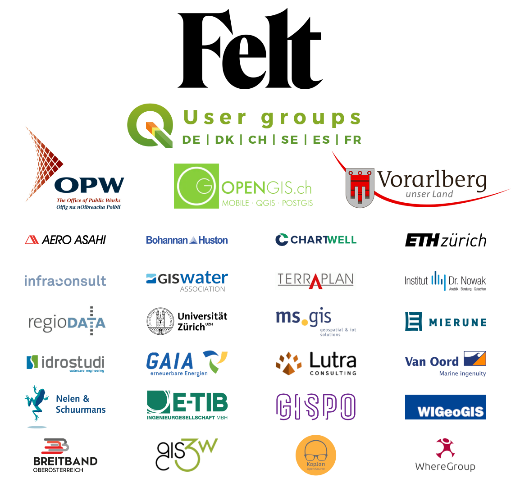

On January 16th, we launched the <a href="https://blog.qgis.org/2023/01/16/crowd-funding-call-2023/">largest crowd-funding call</a> for QGIS.ORG so far. Our goal was to increase <a href="https://qgis.org/en/site/about/sustaining_members.html">sustaining membership contributions</a> and bring the total member contributions up to €200k. And today, we are happy to announce that, thanks to all our new and returning sustaining members, we have succeeded and even exceeded our goal: raising a total of €206.5k in contributions for 2023.

In total, 42 new sustaining members have answered our call &#8211; these are in addition to already existing sustaining members, who started their memberships in previous years &#8211; some of them already many years in a row.

We are particularly happy that we are able to welcome <a href="https://blog.qgis.org/2023/03/21/felt-is-our-first-sustaining-member/">our new and first Flagship sustaining member Felt</a>.  

<figure><figcaption><a href="https://felt.com">felt.com</a></figcaption></figure>

A huge thank you also goes to our returning sustaining member, the <a href="http://www.opw.ie/">Office of Public Works</a> (Ireland) who have increased their contribution to the large membership level.

<figure></figure>

We are also delighted to welcome seven new medium sustaining members, including the first two university institutes supporting us on this level: 

<ul>
<li><a href="https://www.limnowak.com/">Institut Dr. Nowak GmbH, Germany</a> </li>

<li><a href="https://bhinc.com/">Bohannan Huston, New Mexico, USA</a></li>

<li><a href="https://www.geo.uzh.ch/en.html">University of Zurich, Department of Geography, Switzerland</a></li>

<li><a href="https://www.idrostudi.it/">Idrostudi srl, Italy</a></li>

<li><a href="https://ikg.ethz.ch/">ETH Zurich, Institute of Cartography and Geoinformation, Switzerland</a></li>

<li><a href="https://infraconsult.ch/">IC Infraconsult AG, Switzerland</a></li>

<li><a href="https://www.bbooe.at/">BBOÖ Breitband Oberösterreich GmbH, Austria</a></li>
</ul>

And finally, our thanks go out to the stunning 33 new small sustaining members from all over the world: 

<ul>
<li><a href="https://pacgeo.com/">Pacific Geomatics Limited, Canada</a></li>

<li><a href="https://www.helixresources.com.au/">Helix Resources Limited, Australia</a></li>

<li><a href="https://sandhillgeo.com/">Sand Hill Geographic, Virginia, United States</a></li>

<li><a href="https://gispro.com.au/">GIS Pro Western Australia</a></li>

<li><a href="https://spatialdistillery.com/">The Spatial Distillery Company, Victoria, Australia</a></li>

<li><a href="https://www.qwast-gis.com/">Qwast-GIS, The Netherlands</a></li>

<li><a href="https://www.ceicol.com/">CEICOL, Colombia</a></li>

<li><a href="https://qgis.no/">QGIS user group Norway</a></li>

<li><a href="https://robexgold.com/">Robex resources, Quebec, Canada</a></li>

<li><a href="https://www.analygis.ch/">analyGIS GmbH, Switzerland</a></li>

<li><a href="https://www.cartoexpert.com/">CartoExpert, France</a></li>

<li><a href="https://addresscloud.com/">addresscloud, UK</a></li>

<li><a href="https://www.baugeologie.ch/">Baugeologie und Geo-Bau-Labor AG, Switzerland</a></li>

<li><a href="https://spatialthoughts.com/">Spatial Thoughts LLP, India</a></li>

<li><a href="https://www.centremapslive.co.uk/">Centremaps, UK</a></li>

<li><a href="https://geoideal.co/">Geoideal, Colombia</a></li>

<li><a href="https://www.theworks.la/">theworksLA, California, United States</a></li>

<li><a href="https://soft-water.it/">SoftWater s.r.l., Italy</a></li>

<li><a href="https://www.menz-umweltplanung.de/">menz umweltplanung, Germany</a></li>

<li><a href="https://arbonaut.com/">Oy Arbonaut Ltd, Finland</a></li>

<li><a href="https://www.zevross.com/">ZevRoss Spatial Analysis, New York, United States</a></li>

<li><a href="https://www.ecophylla.ca/">Ecophylla Consulting, Ontario, Canada</a></li>

<li><a href="https://www.debeerendevos.be/">DeBeer&amp;DeVos BV, Belgium</a></li>

<li><a href="https://www.r-nc.de/">Reuther NetConsulting, Germany</a></li>

<li><a href="https://www.h13.dk/">H13, Denmark</a></li>

<li><a href="https://www.rockwater.com.au/">Rockwater Pty Ltd, Australia</a></li>

<li><a href="https://www.bgu-geoservice.de/">BGU Dr. Brehm &amp; Grünz GbR, Germany</a></li>

<li><a href="https://juliesdata.com/">Julie&#8217;s Data, Ukraine</a></li>

<li><a href="https://www.loekplan.de/">LökPlan Conze &amp; Cordes GbR, Germany</a></li>

<li><a href="https://osgeo-oceania.org/">OSGeo Oceania, Australia</a></li>

<li><a href="https://www.b-data.io/">b-data GmbH, Switzerland</a></li>

<li><a href="https://www.pma.co.uk/">PMA (Property Market Analysis LLP), UK</a></li>

<li><a href="https://robvq.qc.ca/">ROBVQ (Regroupement des organismes de bassins versants du Québec), Canada</a></li>
</ul>

<figure><figcaption>All sustaining members on flagship, large and medium level </figcaption></figure>
