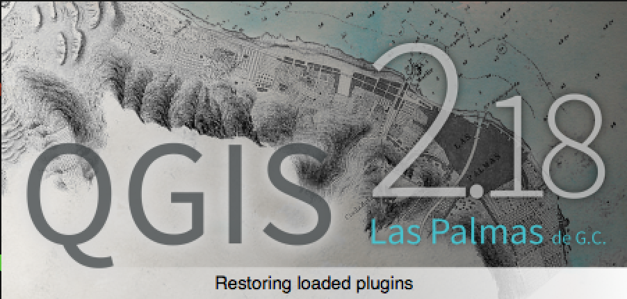

Each year the QGIS.ORG community holds two developer meetings. These events are an important part of  our project &#8211; they provide an invaluable opportunity for us all to meet face to face and share ideas, discuss issues and plan the future of QGIS.

The host of the developer meeting gets a special bonus for hosting the meeting: One of our releases will be named after the town / village / city etc. where the event was held &#8211; like this:

We want to have a better idea of which venues we will be using for future events to help with out planning. So I am putting out a call for venue proposals:

<blockquote>
<strong>If you would like to host a QGIS developer meeting (estimated 50 people per event) or a QGIS Conference (estimated 100-150 people per event) please contact us!</strong>
</blockquote>

Please don&#8217;t submit proposals unless you have the authority to make such a proposal and are willing to act as the local organiser for the event. To make a proposal, fill out <a href="https://goo.gl/forms/hIqXbq0cLdYfiC832">this form</a> and tell us about your great venue!

&nbsp;

