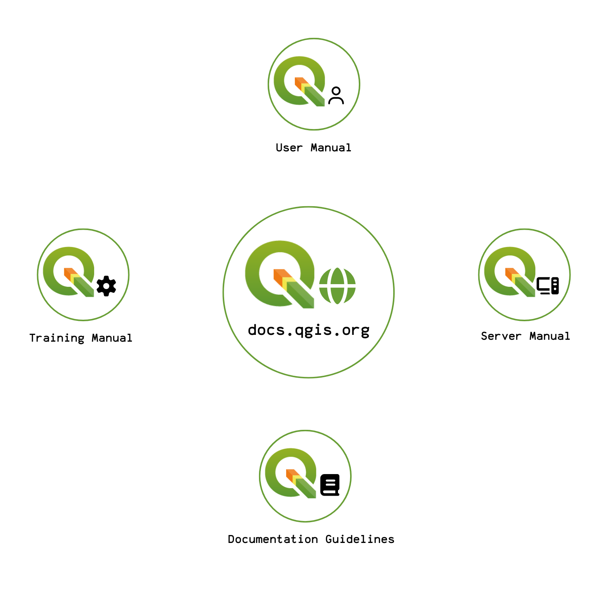
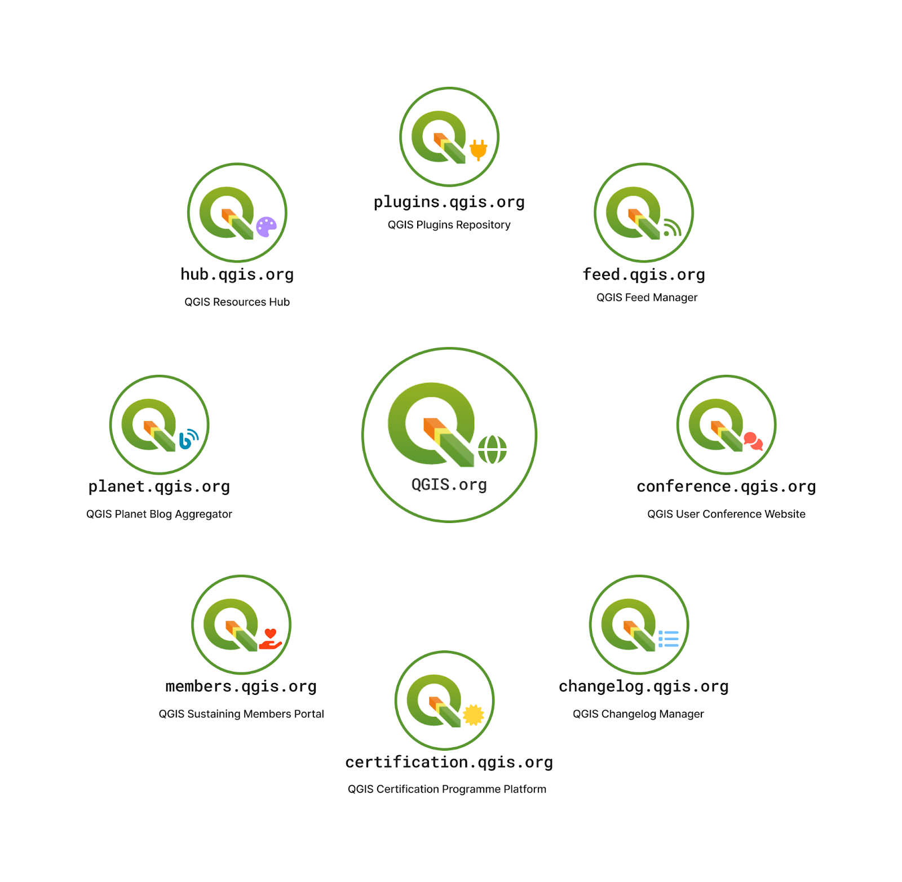
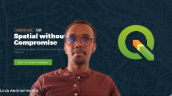
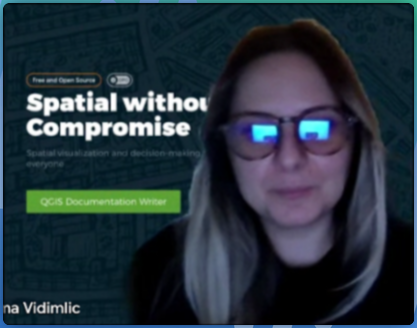
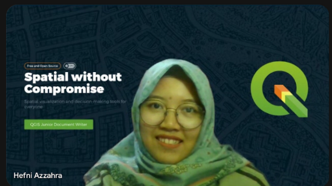

It&#8217;s our pleasure to share our first Documentation and Infrastructure Report with highlights ranging across documentation, web infrastructure, and community-facing work. While this blog post provides a brief summary and team introduction, you can find the full report <a href="https://qgis.org/community/foundation/annual-project-reports/QGISDocs_InfrastructureAnnualReport2025.pdf">here</a>.

Throughout the year, the documentation team, comprised of Selma Vidimlic Husic and Hefni Azzahra (see below for our introductions), focused on improving the quality, accuracy, and completeness of <a href="https://www.qgis.org/resources/hub/#documentation">QGIS documentation</a>. Key efforts included reducing the number of open documentation issues, maintaining existing content, and adding new material where gaps were identified. Further details on these activities and outcomes are described in the full report.

<figure></figure>

At the same time, important improvements were made to the project’s web infrastructure. Lova Andriarimalala led significant maintenance and modernization work, including splitting services across individual VPSs (virtual servers), branding alignment with the new QGIS.org website, and improving overall server performance. These changes increased reliability, improved UI/UX, and provided a more stable foundation for the continued growth of QGIS’s online services.

Overall, 2025 was a year focused on strengthening the core systems that support QGIS users and contributors. 

<figure></figure>

<h1>Team Profile</h1>

<h2>Lova Andriarimalala</h2>

I am a Full-Stack Developer funded by QGIS, specializing in building and maintaining the ecosystem of QGIS websites. My work spans frontend and backend development, infrastructure improvements, performance optimization, UX refinements, and the creation of tools that make QGIS resources easier to navigate. Beyond maintaining the current infrastructure, I contribute to strategic improvements across the QGIS web landscape &#8211; improving architectures, implementing automation, and enhancing contributor workflows. Through this role, I support the broader mission of QGIS by ensuring its online presence reflects the high quality of the software and the vibrant community behind it.

<figure class="is-pulled-right"></figure>

Individual Message: “This year has been a really enjoyable journey working on the QGIS websites. I’ve had the chance to dive into many different parts of the web ecosystem such as fixing issues, improving workflows, cleaning up old parts of the infrastructure, and helping make the sites clearer and more useful for the community. What I appreciated most was how collaborative everything felt: discussing ideas with contributors, learning from the community, and seeing small improvements add up to a better experience for everyone. It’s been a fulfilling year, and I’m excited to keep building on this work.”

Contact: lova@kartoza.com 

<h2>Selma Vidimlic Husic</h2>

I am a QGIS Documentation Writer focused on keeping QGIS user documentation accurate, clear, and aligned with how the software actually works. I test features in QGIS, check behaviour in the source code when needed, and update sections inside the QGIS User Manual and other parts of official documentation. My contributions include writing and editing documentation, reviewing pull requests, improving examples and workflows, onboarding and supporting junior writer and other contributors, and helping ensure that new features are documented consistently. I also support the community by presenting at QGIS events and creating videos that explain documentation updates. My work helps maintain reliable, up-to-date documentation for the global QGIS community.

<figure class="is-pulled-right"></figure>

Individual Message: “This year has been really interesting. I’ve learned a lot about how the open-source community works, improved my technical skills, and expanded on the knowledge I already had. I’ve also gained a clearer understanding of what the documentation writer role involves and how our work contributes to the project. I’m truly grateful for this experience, and I’m especially happy to have had the chance to meet and collaborate with such smart and dedicated people who have made QGIS the great project it is today. I also believe it would be very beneficial if the wider community could be a bit more involved in documentation organisation, particularly when it comes to setting priorities that align with the development plan. This kind of support would help us focus our efforts where they are most needed and ensure that the documentation continues to grow alongside the project. If you want to help, please reach out to me!”

Contact: selma@kartoza.com

<h2>Hefni Azzahra</h2>

I am a Junior QGIS Documentation Writer, I started working for the QGIS project in July 2025. I check how features work in QGIS, update descriptions and examples, and help ensure that new tools are properly documented. I also collaborate with other writers and contributors. My other contributions include creating videos for QGIS sprints to announce documentation updates. I am committed to helping users understand QGIS through clear and up-to-date documentation.

<figure class="is-pulled-right"></figure>

Individual Message: “I’m so grateful for this role. I’ve learned many new things, and until now, every day still feels like learning. From testing features to documenting the process and sharing it with the community, it has all been very rewarding. It feels nice to contribute to the community, even through small things like fixing typos or adding visual examples. Back on my first day, I started by addressing “good first issues” (the GitHub issue label used to indicate issues suitable for those getting started with working on the documentation). Now, here I am, busy with more complex ones. Investigating things has become part of my life. This has been a fulfilling year with QGIS. Collaborating with amazing people and contributing to the community are truly my things. I hope I can continue contributing more and more.”

Contact: hefni@kartoza.com

