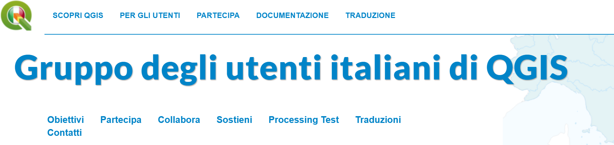

With QGIS 3.0 moving closer, it is also time to get the new <a href="http://blog.qgis.org/2017/01/08/qgis-3-0-logo-voting-results/">QGIS logo</a> out there.

QGIS logo evolution

We are therefore asking all our user groups to join the project redesign efforts. Please have a look at your user group logo and bring it in line with the QGIS 3.0 design.

We have compiled a <strong><a href="http://qgis.org/en/site/getinvolved/styleguide.html">Visual Style Guide</a></strong> which provides all logo materials, including fonts that you can use for your own user group logo. Here is an example of how the Italian user group has updated their logo:

Italian user group redesigned

We are looking forward to seeing all your creative efforts!

