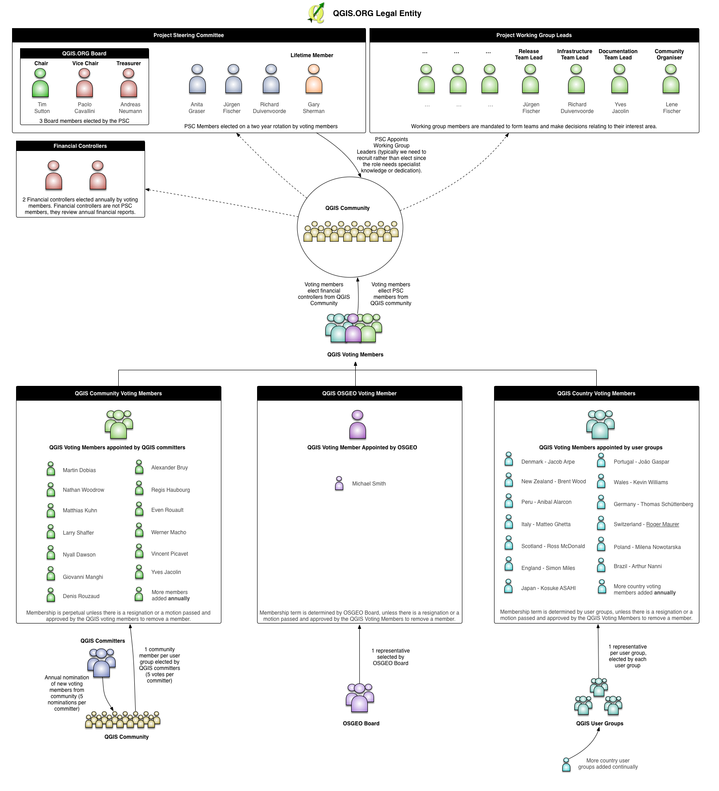

Dear QGIS community members

At the end of December 2016, we held our inaugural Annual General Meeting (AGM). It should be noted that QGIS AGM&#8217;s will be &#8216;virtual&#8217; meetings conducted as a questionnaire (for voting / raising motions) and then a report such as the one below, with optional follow up email discussion if deemed necessary. The reason for this is that our community is spread far and wide and any attempt at an in-person (physical or virtual) meeting will prove very difficult given the number of different time zones the participants live in. Thus this, and future, AGM reports will be a reflection / summary of the various online activities that constitute the &#8216;AGM&#8217; and the reports should be read with this understanding in mind.  It should also be kept in mind that because we are bootstrapping the QGIS Board, the 2016/ 2017 meetings follow a reduced agenda &#8211; the 2018 meeting will commence with the full AGM agenda since we will have a year of financial reporting / board activity etc. behind us. Here follow the minutes:

&nbsp;

<h2><b>Minutes of the Inaugural General Assembly (AGM) 2016 &#8211; Concluded 22 December 2016</b></h2>

Dear QGIS.ORG voting members,

In December 2016 we held a special Inaugural AGM event in order to bootstrap the new governance structures for QGIS.ORG. The following items were tabled during our special AGM to cater for the needed transition from the old organisation to the new:

<h3>Election of incoming board and PSC member replacements</h3>

Under our statutes, existing board / PSC members are automatically put forward for re-election during our PSC elections. A call for nominations was held and closed on 15 December 2016. All voting members were elegible to put forward their nominations. The following valid nominations were received (i.e. for candidates who were not already PSC members):

<ol>
<li>Régis Haubourg</li>
</ol>

Subsequent to the call for nominations, an election was held via online vote. Response rate was 20 out of 27 eligible voters. Under our statutes this is considered a quorum. Election results were as follows:

<table class="table is-fullwidth is-striped is-hoverable">
<tbody>
<tr>
<td><strong>Position</strong></td>
<td><strong>Name</strong></td>
<td><strong>Votes Received</strong></td>
<td><strong>Max Votes</strong></td>
</tr>
<tr>
<td>Chair: QGIS Board</td>
<td>Tim Sutton</td>
<td>19</td>
<td>20</td>
</tr>
<tr>
<td>Vice-Chair: QGIS Board</td>
<td>Paolo Cavallini</td>
<td>12</td>
<td>20</td>
</tr>
<tr>
<td>Treasurer: QGIS Board</td>
<td>Andreas Neumann</td>
<td>20</td>
<td>20</td>
</tr>
<tr>
<td>PSC Member</td>
<td>Richard Duivenvoorde</td>
<td>17</td>
<td>20</td>
</tr>
<tr>
<td>PSC Member</td>
<td>Anita Graser</td>
<td>16</td>
<td>20</td>
</tr>
<tr>
<td>PSC Member</td>
<td>Jϋrgen Fischer</td>
<td>14</td>
<td>20</td>
</tr>
<tr>
<td>Honorary PSC Member</td>
<td>Gary Sherman</td>
<td>&#8211;</td>
<td>&#8211;</td>
</tr>
</tbody>
</table>

Note that each voting member was allowed 6 votes, but was not allowed to vote for the same person more than once. For the Board Member positions, which were specifically named, the candidate with the greatest number of votes for each role assigned that role. The PSC member positions were calculated based on the total number of votes each candidate received (including those allocated to named board roles). In accordance with our statutes, Gary Sherman remains on the PSC on a permanent basis as Honorary PSC member.

<h3>Election of the board chair</h3>

Election of the board chair was carried out as part of the general voting process. The successful candidate was Tim Sutton.

<h3>Matters brought forward by voting members</h3>

There were no matters brought forward by voting members.

<h3>Annual AGM for 2017</h3>

Now that the special AGM has been held and the Board and PSC constituted, we will hold our first AGM in the first quarter of 2017 (and then each year thereafter will be held in the first quarter). The 2017 AGM will be a reduced format since we will have just elected the PSC and Board, 

<b>Agenda for 2017 AGM:</b>

<ol>
<li>Approval of the annual report (2016) by the chair</li>
<li>Approval of the annual financial report (2016)</li>
<li>Approval of the 2017 budget</li>
<li>Election of two financial auditors for the upcoming year</li>
<li>Deal with matters brought forward by voting members</li>
</ol>

&nbsp;

Given the outcomes of the end-2016 AGM, the QGIS Governance now looks like this (click for larger version):

If you have any queries about the QGIS Governance processes, please do not hesitate to ask!

Regards

Tim Sutton (QGIS Project Chair)

&nbsp;

