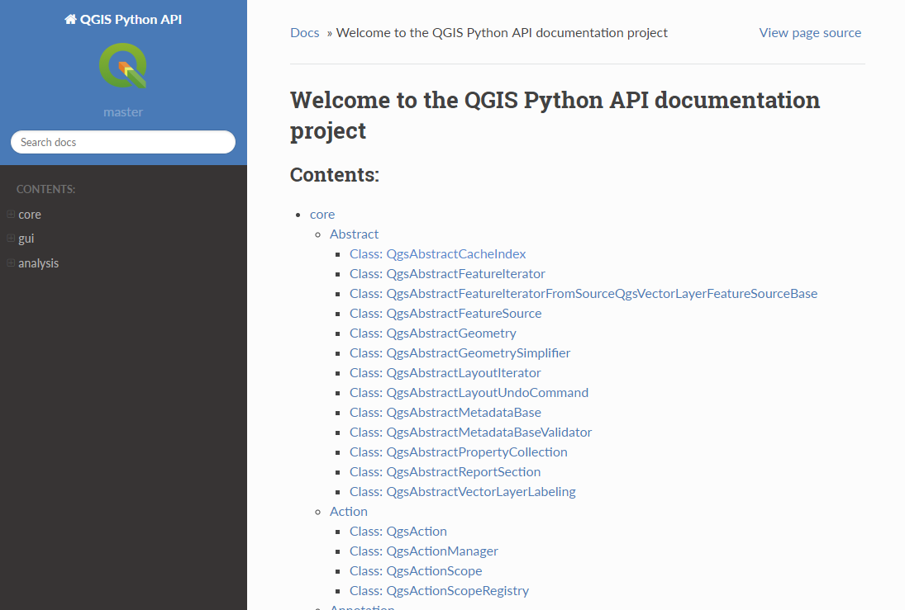

We are proud to announce our new dedicated documentation of the QGIS Python API (also called PyQGIS) which is now available at <a href="https://qgis.org/pyqgis/master" target="_blank" rel="noopener">https://qgis.org/pyqgis</a>:

While the QGIS API has long been documented, Python developers in the past had to work with the general C++ documentation that wasn&#8217;t always straightforward to use. The new PyQGIS documentation presents the API in an accessible pythonic manner.

Of course, creating a good API documentation from source code in an automated way, is not trivial. A key challenge was to automatically create Python bindings files (or SIP files). A custom Perl script known as &#8220;sipify&#8221; now enables us to automatically integrate the C++ documentation into the Python bindings and keep them up to date. Another challenge was to create the documentation itself using Sphinx. Two detailed reports containing all the technical details of the <a href="https://cloud.opengis.ch/index.php/s/n6HBCzPWrWqa5di">first</a> and <a href="https://lists.osgeo.org/pipermail/qgis-psc/2018-April/006090.html">second</a> generation of the documentation are available if you want to learn more about the underlying architecture.

This has been a really important infrastructure project for QGIS that has been made possible by support from our <a href="https://qgis.org/en/site/about/sponsorship.html#">donors and sponsors</a>, as well as the generous in-kind contributions of our community members.

