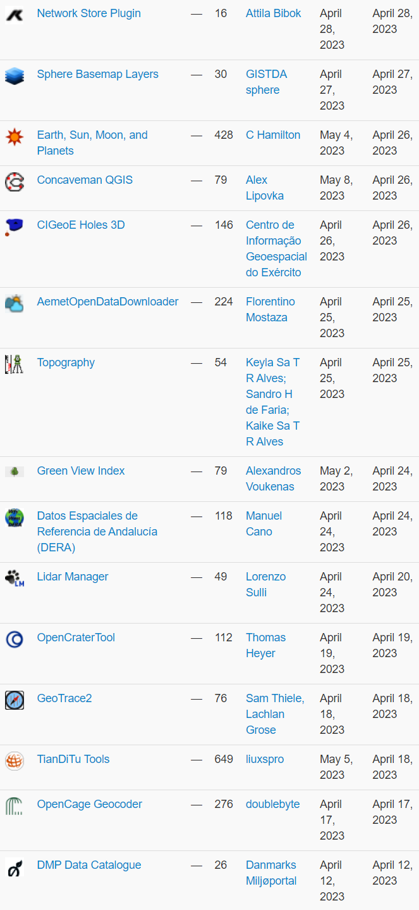
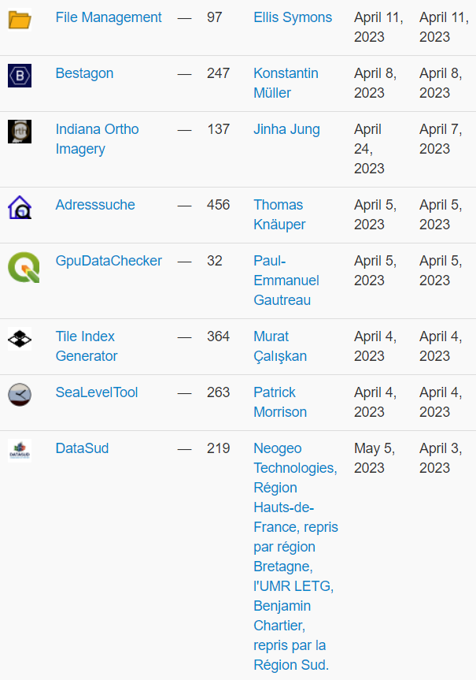

April wasn&#8217;t just the month of our wonderful <a href="https://blog.qgis.org/2023/04/27/reporting-back-from-the-user-conference-contributor-meeting-in-den-bosch/">user conference and contributor meeting</a>, it was also a month with a whopping 23 new plugins that have been published in the <a href="https://plugins.qgis.org/plugins/">QGIS plugin repository</a>. 

Here&#8217;s the quick overview in reverse chronological order. If any of the names or short descriptions piques your interest, you can find the direct link to the plugin page in the table below the screenshot.

<figure></figure>

<figure></figure>

<figure class="table-container"><table class="table is-fullwidth is-striped is-hoverable"><thead><tr><th></th></tr></thead><tbody><tr><td><a href="https://plugins.qgis.org/plugins/network-store-qgis/">Network Store Plugin</a></td></tr><tr><td>export layers to kisters network store</td></tr><tr><td><a href="https://plugins.qgis.org/plugins/sphere_basemap_layers/">Sphere Basemap Layers</a></td></tr><tr><td>This plugin let you to add a variety of thailand basemap from GISTDA sphere Open Platform</td></tr><tr><td><a href="https://plugins.qgis.org/plugins/earthsunmoon/">Earth, Sun, Moon, and Planets</a></td></tr><tr><td>Tools to calculate the positions of the sun, moon, and planets when viewed from directly overhead for a particular date and time. It displays solar and lunar information for a coordinate at the specified date and time. (Note the Python library dependencies.)</td></tr><tr><td><a href="https://plugins.qgis.org/plugins/concaveman_qgis/">Concaveman QGIS</a></td></tr><tr><td>Makes concave hull for points</td></tr><tr><td><a href="https://plugins.qgis.org/plugins/cigeoe_holes_3d/">CIGeoE Holes 3D</a></td></tr><tr><td>Draws holes in polygons (3D)</td></tr><tr><td><a href="https://plugins.qgis.org/plugins/AemetOpenDataDownloader/">AemetOpenDataDownloader</a></td></tr><tr><td>This Plugin download open data from aemet</td></tr><tr><td><a href="https://plugins.qgis.org/plugins/topography/">Topography</a></td></tr><tr><td>The plugin is available in this first version with the functionality to calculate closed polygons using the projections method.</td></tr><tr><td><a href="https://plugins.qgis.org/plugins/green_view_index/">Green View Index</a></td></tr><tr><td>A plugin for Green View Index (GVI) operations</td></tr><tr><td><a href="https://plugins.qgis.org/plugins/wms_wfs_dera/">Datos Espaciales de Referencia de Andalucía (DERA)</a></td></tr><tr><td>Loading of wfs/wms services from DERA Spatial Reference Data.Carga de los servicios wfs/wms de los Datos Espaciales de Referencia DERA</td></tr><tr><td><a href="https://plugins.qgis.org/plugins/LidarManager/">Lidar Manager</a></td></tr><tr><td>Manage LiDAR (dtm/dsm) dataset from Tile Index Layer</td></tr><tr><td><a href="https://plugins.qgis.org/plugins/opencratertool/">OpenCraterTool</a></td></tr><tr><td>A tool to measure and compare craters</td></tr><tr><td><a href="https://plugins.qgis.org/plugins/geo_trace/">GeoTrace2</a></td></tr><tr><td>A QGIS plugin for geological mapping</td></tr><tr><td><a href="https://plugins.qgis.org/plugins/tianditu-tools/">TianDiTu Tools</a></td></tr><tr><td>天地图底图加载</td></tr><tr><td><a href="https://plugins.qgis.org/plugins/opencage_geocoder/">OpenCage Geocoder</a></td></tr><tr><td>Geocoding using the OpenCage API</td></tr><tr><td><a href="https://plugins.qgis.org/plugins/dmpcatalogue/">DMP Data Catalogue</a></td></tr><tr><td>Discover and add layers from the Danish Miljøportal data catalog</td></tr><tr><td><a href="https://plugins.qgis.org/plugins/file_management/">File Management</a></td></tr><tr><td>Plugin to help with file management from the Layers Panel.</td></tr><tr><td><a href="https://plugins.qgis.org/plugins/Bestagon-master/">Bestagon</a></td></tr><tr><td>Form (mostly Hexagon) generator for point intensities</td></tr><tr><td><a href="https://plugins.qgis.org/plugins/indiana_ortho/">Indiana Ortho Imagery</a></td></tr><tr><td>This plugin provide easy access to Indiana Ortho Imageries</td></tr><tr><td><a href="https://plugins.qgis.org/plugins/address_search/">Adresssuche</a></td></tr><tr><td>Searching for an adresspoint in Germany based on offical data &#8211; ALKIS Adresssuche</td></tr><tr><td><a href="https://plugins.qgis.org/plugins/gpu-data-checker/">GpuDataChecker</a></td></tr><tr><td>Plugin pour l&#8217;aide au contrôle de la validité géométrique de données pour intégration dans le géoportail de l&#8217;urbanisme</td></tr><tr><td><a href="https://plugins.qgis.org/plugins/tile_index_generator/">Tile Index Generator</a></td></tr><tr><td>This plugin creates tile index in vector format for XYZ tiles.</td></tr><tr><td><a href="https://plugins.qgis.org/plugins/qgis_sea_level_tool/">SeaLevelTool</a></td></tr><tr><td>Adjust styling on raster layer by a sea level curve.</td></tr><tr><td><a href="https://plugins.qgis.org/plugins/datasud/">DataSud</a></td></tr><tr><td>Plugin pour QGIS 3 fournissant un accès simple aux flux de données géographiques (WMS, WFS) publiées par la Région Sud sur DataSud.fr.</td></tr></tbody></table></figure>
