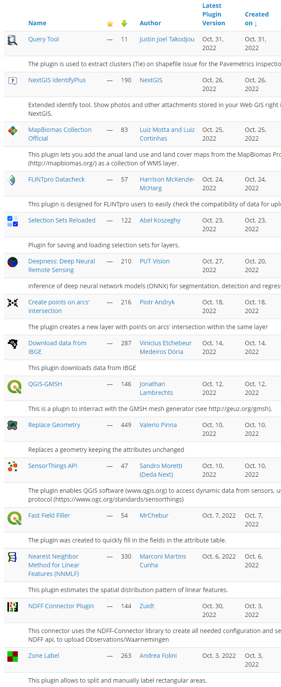

The QGIS plugin repository currently lists 1728 plugins and the list keeps on growing. October has been busy with 15 new plugins. It can be challenging to stay up to date. 

Our monthly plugin update is meant to provide you a quick overview of the newest plugins. If any of the names or short descriptions piques your interest, you can find the direct link to the plugin page in the table below the screenshot.

<figure></figure>

<figure class="table-container"><table class="table is-fullwidth is-striped is-hoverable"><tbody><tr><td><a href="https://plugins.qgis.org/plugins/Query_Tool/">Query Tool</a></td></tr><tr><td>The plugin is used to extract clusters (Tie) on shapefile issue for the Pavemetrics inspections systems.</td></tr><tr><td><a href="https://plugins.qgis.org/plugins/identifyplus/">NextGIS IdentifyPlus</a></td></tr><tr><td>Extended identify tool. Show photos and other attachments stored in your Web GIS right in QGIS. Developed by NextGIS.</td></tr><tr><td><a href="https://plugins.qgis.org/plugins/plugin/">MapBiomas Collection Official</a></td></tr><tr><td>This plugin lets you add the anual land use and land cover maps from the MapBiomas Project (<a href="http://mapbiomas.org/">http://mapbiomas.org/</a>) as a collection of WMS layer.</td></tr><tr><td><a href="https://plugins.qgis.org/plugins/flintpro_datacheck/">FLINTpro Datacheck</a></td></tr><tr><td>This plugin is designed for FLINTpro users to easily check the compatibility of data for uploading to FLINTpro.</td></tr><tr><td><a href="https://plugins.qgis.org/plugins/selection-sets-reloaded/">Selection Sets Reloaded</a></td></tr><tr><td>Plugin for saving and loading selection sets for layers.</td></tr><tr><td><a href="https://plugins.qgis.org/plugins/deepness/">Deepness: Deep Neural Remote Sensing</a></td></tr><tr><td>Inference of deep neural network models (ONNX) for segmentation, detection and regression</td></tr><tr><td><a href="https://plugins.qgis.org/plugins/point_on_arc_intersection/">Create points on arcs&#8217; intersection</a></td></tr><tr><td>The plugin creates a new layer with points on arcs&#8217; intersection within the same layer</td></tr><tr><td><a href="https://plugins.qgis.org/plugins/ibgedatadownloader/">Download data from IBGE</a></td></tr><tr><td>This plugin downloads data from IBGE</td></tr><tr><td><a href="https://plugins.qgis.org/plugins/qgis-gmsh/">QGIS-GMSH</a></td></tr><tr><td>This is a plugin to interract with the GMSH mesh generator (see <a href="http://geuz.org/gmsh">http://geuz.org/gmsh</a>).</td></tr><tr><td><a href="https://plugins.qgis.org/plugins/replace_geometry/">Replace Geometry</a></td></tr><tr><td>Replaces a geometry keeping the attributes unchanged</td></tr><tr><td><a href="https://plugins.qgis.org/plugins/SensorThingsAPI/">SensorThings API</a></td></tr><tr><td>The plugin enables QGIS to access dynamic data from sensors, using SensorThings API protocol (<a href="https://www.ogc.org/standards/sensorthings">https://www.ogc.org/standards/sensorthings</a>)</td></tr><tr><td><a href="https://plugins.qgis.org/plugins/examples/">Fast Field Filler</a></td></tr><tr><td>The plugin was created to quickly fill in the fields in the attribute table.</td></tr><tr><td><a href="https://plugins.qgis.org/plugins/nnmlf/">Nearest Neighbor Method for Linear Features (NNMLF)</a></td></tr><tr><td>This plugin estimates the spatial distribution pattern of linear features.</td></tr><tr><td><a href="https://plugins.qgis.org/plugins/ndff_connector_plugin/">NDFF Connector Plugin</a></td></tr><tr><td>This connector uses the NDFF-Connector library to create all needed configuration and settings to connect to the NDFF api, to upload Observations/Waarnemingen</td></tr><tr><td><a href="https://plugins.qgis.org/plugins/zone_label/">Zone Label</a></td></tr><tr><td>This plugin allows to split and manually label rectangular areas.</td></tr></tbody></table></figure>
