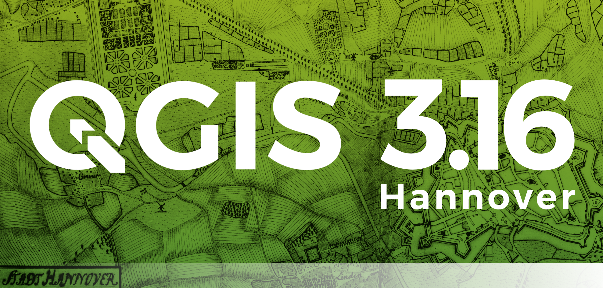

We are pleased to announce the release of QGIS 3.16 &#8216;Hannover&#8217;!

<a href="https://qgis.org/en/site/forusers/download.html">Installers for all supported operating systems </a>are already out. QGIS 3.16 comes with tons of new features, as you can see in <a href="https://qgis.org/en/site/forusers/visualchangelog316/">our visual changelog</a>.

We would like to thank the developers, documenters, testers and all the many folks out there who volunteer their time and effort (or fund people to do so). From the QGIS community we hope you enjoy this release! If you wish to donate time, money or otherwise get involved in making QGIS more awesome, please wander along to <a class="reference external" href="http://qgis.org/">qgis.org</a> and lend a hand!

QGIS is supported by donors and sustaining members. A current list of donors who have made financial contributions large and small to the project can be seen on our <a class="reference external" href="http://qgis.org/en/site/about/sponsorship.html#list-of-donors">donors list</a>. If you would like to become a sustaining member, please visit <a class="reference external" href="http://qgis.org/en/site/about/sponsorship.html#sponsorship">our page for sustaining members</a> for details. Your support helps us fund our six monthly developer meetings, maintain project infrastructure and fund bug fixing efforts.

QGIS is Free software and you are under no obligation to pay anything to use it &#8211; in fact we want to encourage people far and wide to use it regardless of what your financial or social status is &#8211; we believe empowering people with spatial decision making tools will result in a better society for all of humanity.

