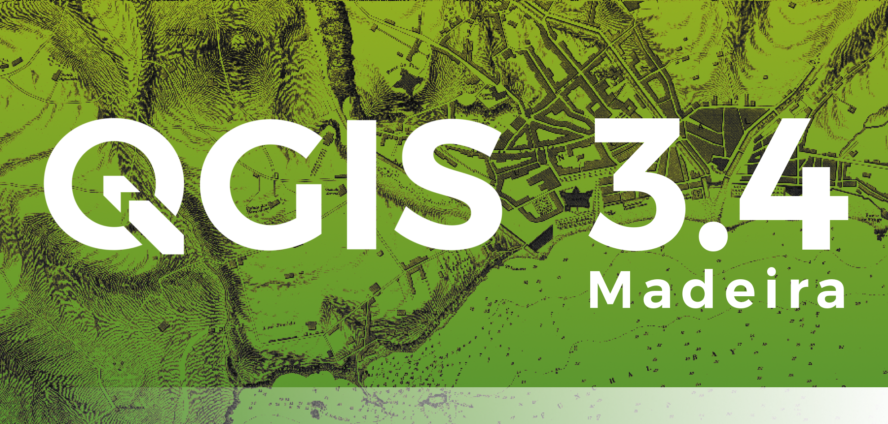

We are pleased to announce the release of QGIS 3.4 &#8216;Madeira&#8217;! Madeira was the location of our developer meeting in February 2018.

<a href="https://qgis.org/en/site/forusers/download.html">Windows installers and Ubuntu/debian binaries </a>are already out, and all the packagers are actively preparing packages for the other operating systems. We&#8217;ll keep you updated when different packages and installers become available.

QGIS 3.4 comes with tons of new features, as you can see in <a href="https://qgis.org/en/site/forusers/visualchangelog34/">our visual changelog</a>.

QGIS 3.4 will become the first LTR of version 3. Based on<a href="https://qgis.org/en/site/getinvolved/development/roadmap.html#release-schedule"> our current plans</a>, 3.4 will replace 2.18 as LTR in February 2019.

We would like to thank the developers, documenters, testers and all the many folks out there who volunteer their time and effort (or fund people to do so). From the QGIS community we hope you enjoy this release! If you wish to donate time, money or otherwise get involved in making QGIS more awesome, please wander along to <a class="reference external" href="http://qgis.org/">qgis.org</a> and lend a hand!

QGIS is supported by donors and sponsors. A current list of donors who have made financial contributions large and small to the project can be seen on our <a class="reference external" href="http://qgis.org/en/site/about/sponsorship.html#list-of-donors">donors list</a>. If you would like to become an official project sponsor, please visit <a class="reference external" href="http://qgis.org/en/site/about/sponsorship.html#sponsorship">our sponsorship page</a> for details. Sponsoring QGIS helps us to fund our six monthly developer meetings, maintain project infrastructure and fund bug fixing efforts. A complete list of current sponsors is provided below &#8211; our very great thank you to all of our sponsors!

QGIS is Free software and you are under no obligation to pay anything to use it &#8211; in fact we want to encourage people far and wide to use it regardless of what your financial or social status is &#8211; we believe empowering people with spatial decision making tools will result in a better society for all of humanity.

