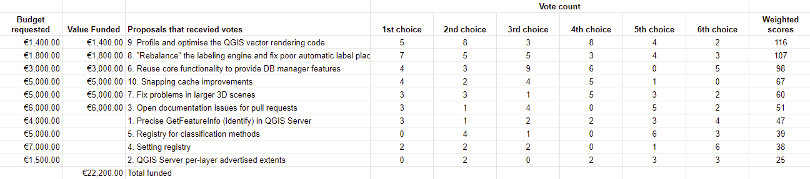

We are extremely pleased to announce the winning proposals for our 2019 QGIS.ORG grant programme. Funding for the programme was sourced by you, our <a href="https://www.qgis.org/en/site/about/sponsorship.html">project donors and sponsors</a>! <strong>Note:</strong> For more context surrounding our grant programme, please see: <a href="http://blog.qgis.org/2019/05/06/qgis-grants-4-call-for-grant-proposals-2019/">QGIS Grants #4: Call for Grant Proposals 2019</a>.

The QGIS.ORG Grant Programme aims to support work from our community that would typically not be funded by client/contractor agreements. For the first time, this year we did not accept proposals for the development of new features. Instead proposals should focus on infrastructure improvements and polishing of existing features.

Voting to select the successful projects was carried out by our QGIS Voting Members. Each voting member was allowed to select up to 6 of the 10 submitted proposals by means of a ranked selection form. The full list of votes are available <a href="https://docs.google.com/spreadsheets/d/1f6eAOW8XyxIfuQA1JF5qR1TinDQugofOrNoPJpY-ZUo/edit?usp=sharing">here</a> (on the first sheet). The second sheet contains the calculations used to determine the winner (for full transparency). The table below summarizes the voting tallies for the proposals:

A couple of extra notes about the voting process:

<ul>
<li>The PSC has an ongoing program to fund documentation so elected to fund the proposal &#8220;Open documentation issues for pull requests&#8221; even if this increases the total funded amount beyond the initial budget.</li>
<li>Although the budget for the grant programme was €20,000, the total amount for the winning proposals is €22,200. This increase is possible thanks to the generous support by our donors and sponsors this year.</li>
<li>Voting was carried out based on the technical merits of the proposals and the competency of the applicants to execute on these proposals.</li>
<li>No restrictions were in place in terms of how many proposals could be submitted per person / organization, or how many proposals could be awarded to each proposing person / organization.</li>
<li>Voting was ‘blind’ (voters could not see the existing votes that had been placed).</li>
</ul>

We received 31 votes from 16 community representatives and 15 user group representatives.

On behalf of the QGIS.ORG project, I would like to thank everyone who submitted proposals for this call!

A number of interesting and useful proposal didn’t make it because of our limited budget; we encourage organizations to pick up one of their choice and sponsor it.

