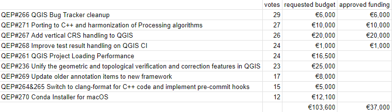

We are extremely pleased to announce the 4 winning proposals for our 2023 QGIS.ORG grant programme:

<ul>
<li><a href="https://github.com/qgis/QGIS-Enhancement-Proposals/issues/266">QEP#266 QGIS Bug Tracker cleanup</a></li>

<li><a href="https://github.com/qgis/QGIS-Enhancement-Proposals/issues/271">QEP#271 Porting to C++ and harmonization of Processing algorithms</a></li>

<li><a href="https://github.com/qgis/QGIS-Enhancement-Proposals/issues/267">QEP#267 Add vertical CRS handling to QGIS</a></li>

<li><a href="https://github.com/qgis/QGIS-Enhancement-Proposals/issues/268">QEP#268 Improve test result handling on QGIS CI</a></li>
</ul>

Funding for the programme was sourced by you, our <a href="https://www.qgis.org/en/site/about/sponsorship.html">project donors and sponsors</a>! <strong>Note:</strong> For more context surrounding our grant programme, please see: <a href="https://blog.qgis.org/2023/04/04/qgis-grants-8-call-for-grant-proposals-2023/">QGIS Grants #8: Call for Grant Proposals 2023</a>.

The QGIS.ORG Grant Programme aims to support work from our community that would typically not be funded by client/contractor agreements. This means that we did not accept proposals for the development of new features. Instead proposals focus on infrastructure improvements and polishing of existing features.

Voting to select the successful projects was carried out by our QGIS Voting Members. Each voting member was allowed to select up to 6 proposals. The full list of votes are available <a href="https://docs.google.com/spreadsheets/d/1xdgpYwt1g39pRYcCm1XbqNC2yXfb7aXtf_3RALr2PQc/edit?usp=sharing">here</a> (on the first sheet). The following sheets contain the calculations used to determine the winner (for full transparency). The table below summarizes the voting tallies for the proposals:

<figure></figure>

A couple of extra notes about the voting process:

<ul>
<li>Voting was carried out based on the technical merits of the proposals and the competency of the applicants to execute on these proposals.</li>

<li>No restrictions were in place in terms of how many proposals could be submitted per person / organization, or how many proposals could be awarded to each proposing person / organization.</li>

<li>Voting was ‘blind’ (voters could not see the existing votes that had been placed).</li>
</ul>

We received 35 votes from 20 community representatives and 15 user group representatives.

On behalf of the QGIS.ORG project, I would like to thank everyone who submitted proposals for this call!

