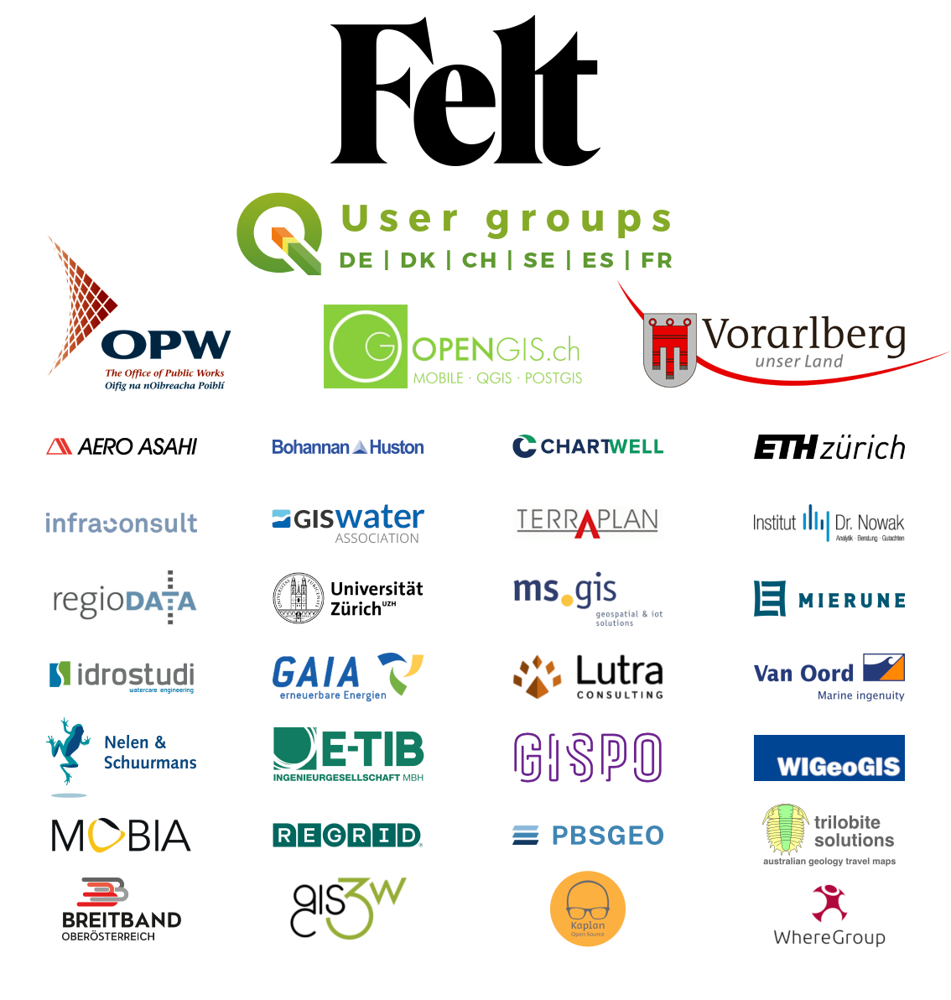

Thanks to our generous donors and sustaining members, we are in the wonderful position to be able to further extend our 2023 Grant Programme and to fund two additional projects that came in <a href="https://blog.qgis.org/2023/06/26/qgis-grant-programme-2023-results/">very close 5th and 6th in the voting results</a>: 

<ul>
<li><a href="https://github.com/qgis/QGIS-Enhancement-Proposals/issues/261">QEP#261 Cachable provider metadata API &#8212; or how to ⚡ the QGIS loading times</a></li>

<li><a href="https://github.com/qgis/QGIS-Enhancement-Proposals/issues/236">QEP#236 Unification of all geometric and topological verification methods</a></li>
</ul>

On behalf of the QGIS.ORG project, I would like to thank everyone who helped with the fund raising and everyone who stepped up and joined our donor and <a href="https://qgis.org/en/site/about/sustaining_members.html#">sustaining membership programme</a>. 

<figure></figure>
