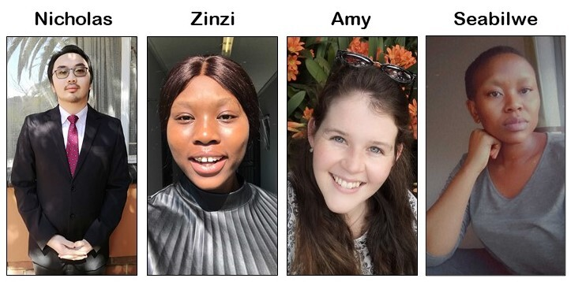

Dear QGIS Users

On Friday, 26 March 2021 we will be holding our monthly QGIS Open Day! What is a QGIS Open Day you may be wondering to yourself? It is an initiative to replace the wonderful community meetups we used to hold every six months when times were different. Like our in-person meetings, the event is organised on the principle of self-organisation and community participation.

<strong>Programme</strong>

<ul><li>QGIS INTEGRATED (The open day that shows QGIS working as part of an ecosystem with other software and programs to create dynamic and shareable spatial data, maps, and systems)</li></ul>

<strong>Where to watch</strong>

Please see the event wiki page at <a href="https://github.com/qgis/QGIS/wiki/QHF-March-2021">QHF-March-2021 Wiki</a> for all the details of times and links for participation.

<h1></h1>

<h1>Recordings</h1>

All of the YouTube live-streamed events will be recorded and made available to users who couldn&#8217;t make the live events. YouTube live streams sometimes take 24 hours to be available for catch-up viewing. Be sure to check back here for updates!

<h1></h1>

<h1>Code of Conduct</h1>

Participants are kindly reminded to please read and observe our QGIS Code of Conduct and Diversity Statement to make these events a great experience for everyone!

<ul><li><a href="https://www.qgis.org/en/site/getinvolved/governance/codeofconduct/codeofconduct.html">Code of Conduct</a></li><li><a href="https://www.qgis.org/en/site/getinvolved/governance/codeofconduct/diversitystatement.html">Diversity Statement</a></li></ul>

Please contact me, <ins>Zinziswa Xakayi</ins> by email <a href="mailto:zeighxakayi@gmail.com">zeighxakayi@gmail.com</a> or via the <a href="https://t.me/joinchat/Aq2V5RPoxYYhXqUPoxRWPQ">Telegram Channel</a> username <ins>@zinzixakayi</ins> if you have any queries or need help setting up events.

We look forward to seeing you there!

Regards

<figure></figure>

The QGIS Open Day Organising Team!

