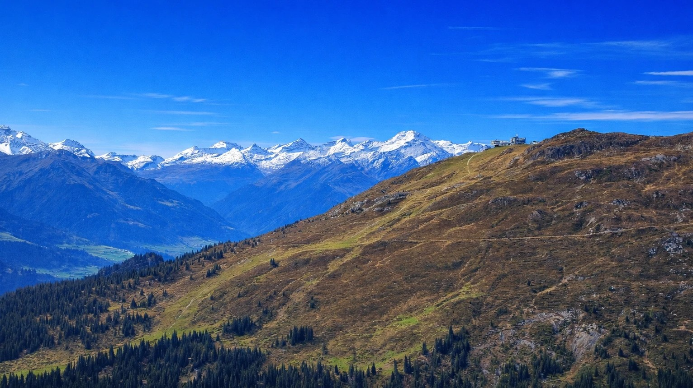
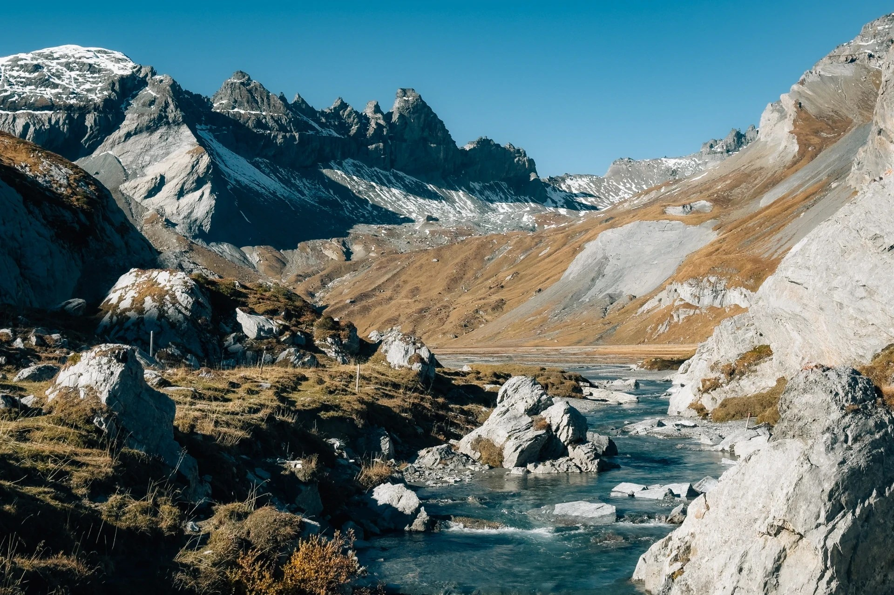
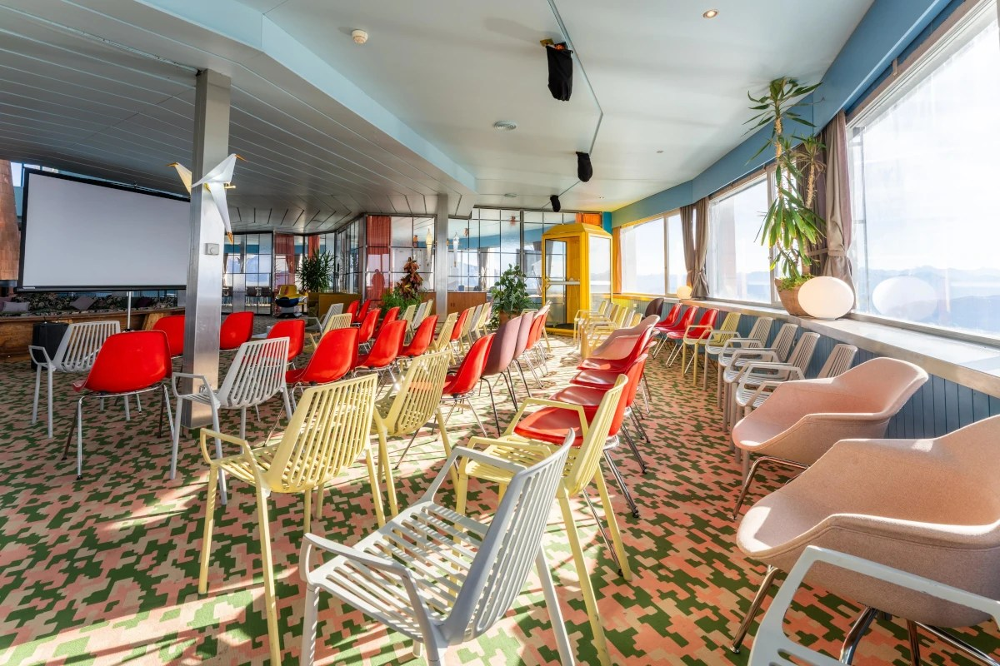

We are happy to announce that the <strong>QGIS User Conference 2026</strong> will take place on <strong>5–6 October 2026</strong> in <strong>Laax</strong>, in the heart of the Swiss Alps. Visit the <a href="https://conference.qgis.org/">conference website</a> to find out all details.

<figure></figure>

The conference will be hosted at <strong>Crap Sogn Gion</strong>, at <strong>2,222 metres above sea level</strong>, offering a unique setting with panoramic mountain views and direct access to the surrounding alpine landscape. Despite its mountain location, Laax is well connected by public transport and provides a wide range of accommodation options in the valley.

As Chair of the <strong>QGIS Project</strong> and of the QGIS User Conference 2026, I’m very much looking forward to welcoming the community in my hometown and place of birth of QField.

<figure></figure>

The conference will bring together users, developers, and contributors from around the world for two days of presentations, workshops, and discussions covering a wide range of QGIS-related topics. Around the main conference days, additional events are planned, including workshops, community activities, and the QGIS Contributor Meeting.

<figure></figure>

More information about the program, tickets, and related events will be published over the coming months on the conference website <strong><a href="https://conference.qgis.org/">https://conference.qgis.org/</a></strong>

We are looking forward to welcoming you to Laax in October 2026. Cheers Marco

