
We just wrapped up the 3rd QGIS User Conference at the University of Copenhagen&#8217;s &#8220;Skovskolen&#8221; Forestry and Landscape College, just outside of Copenhagen. The conference <a href="https://qgis2017.wordpress.com/presentations/">programme</a> was split into three parts:

<ol>
<li>A general user conference of three days</li>
<li>The a QGIS hackfest &#8211; where many developers brought their families along</li>
<li>A week of workshops where attendees can learn in-depth topics such as expressions or the new QGIS Web Client version 2</li>
</ol>

We are extremely grateful to the event sponsors (you can find links to our sponsors at the bottom of this page):

<figure class="image">

<figcaption class="is-size-7">University of Copenhagen (Host).</figcaption>
</figure>

<figure class="image">

<figcaption class="is-size-7">COWI</figcaption>
</figure>

<figure class="image">

<figcaption class="is-size-7">ArtoGIS</figcaption>
</figure>

<figure class="image">

<figcaption class="is-size-7">BoundlessGeo</figcaption>
</figure>

<figure class="image">

<figcaption class="is-size-7">SunGIS</figcaption>
</figure>

<figure class="image">

<figcaption class="is-size-7">QGIS Usergroup Denmark</figcaption>
</figure>

<figure class="image">

</figure>

<figure class="image">

</figure>

<figure class="image">

</figure>

&nbsp;

Here are some of the highlights from the conference presentations:

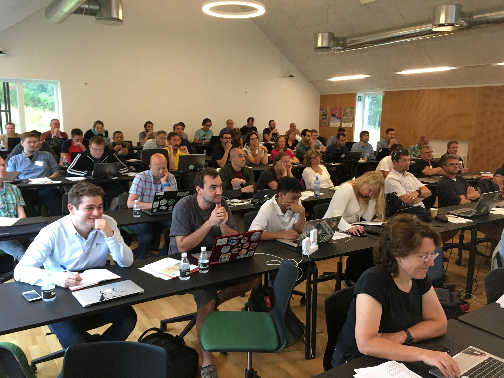

<strong>Search &#8211; a cool unified</strong><strong>search tool for QGIS</strong>

<a href="klavsphilkjaer.jpg">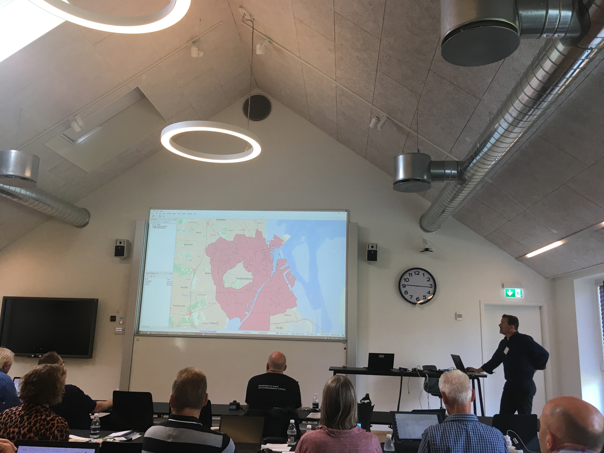</a>

Klavs Pihlkjaer (from Septima) showed off the QGIS (version 2) search plugin. The plugin provides a unified search interface for datasets loaded in QGIS. You can also search external OGC services. If you are still using QGIS 2.x releases, run, don’t walk to try the search plugin. The Search Plugin also allows you to create third party plugins (via a simple python API) that integrate with it by adding new search sources to the list. If you are using QGIS 3, check out the ability to write plugins for the new locator bar! Klavs is still looking at porting his work over to work with the upcoming QGIS 3 release.

<strong>Impact Analysis plugin</strong>

Bo Victor Thomsen showed off the plugin he has built to support searching through many layers in multiple databases and database tables in a fast an efficient way. The layers do not need to be loaded in QGIS and the system uses a centralized configuration management approach so that adding new searchable sources is done once and is then immediately available for all users (e.g. in an enterprise environment) of the plugin. The plugin is currently used when searching municipal databases to see if there is any impact assessment needed or inspection needed in a given place.

<a href="bovictorthomsen.jpg">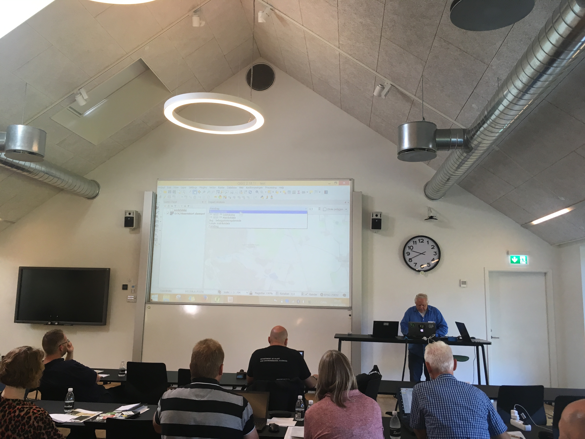</a>

<strong>Danish National Data Search</strong>

Mie Winstrup and Tom Weber showed off the national data search plugins they have developed for Denmark that allow you to easily search for local and national data. They want to be an example for other countries to show how easy it is to make national data searchable and available.

<a href="miewinstrup.jpg">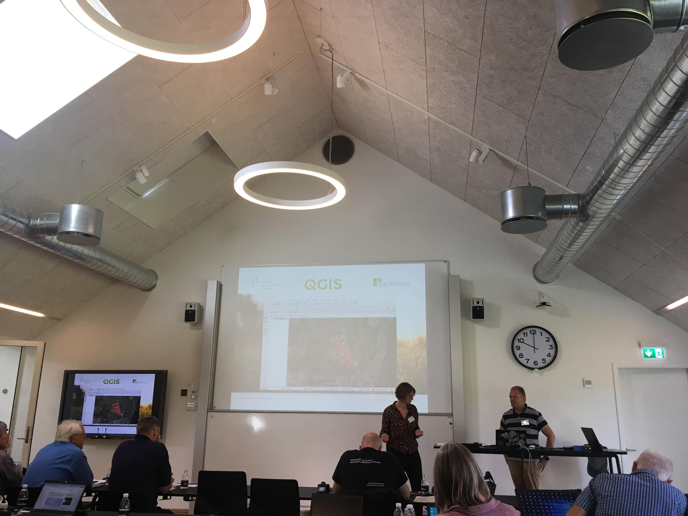</a>

<strong>Casper Bertelsen on registering urban green areas</strong>

Casper showed the system he has developed for managing a cadaster of green spaces. The system includes versioning so that you can see changes over time. It also implements topology rules to ensure that areas do not overlap. He also provides tools for administrations to e.g. see what the maintenance cost for a given area will be.

<a href="casperbertelsen.jpg">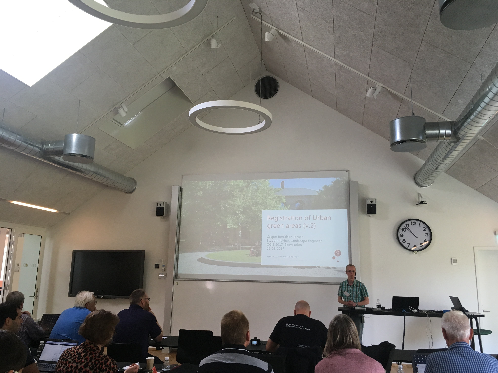</a>

<strong>QGIS as a digitizing platfom</strong>

Saber Razmjooei from Lutra Consulting showed off QGIS as a digitizing platform. He also showed us new digitizing coming in QGIS 3. He showed off some of the great tools coming in QGIS 3 for node editing.

<a href="saber.jpg">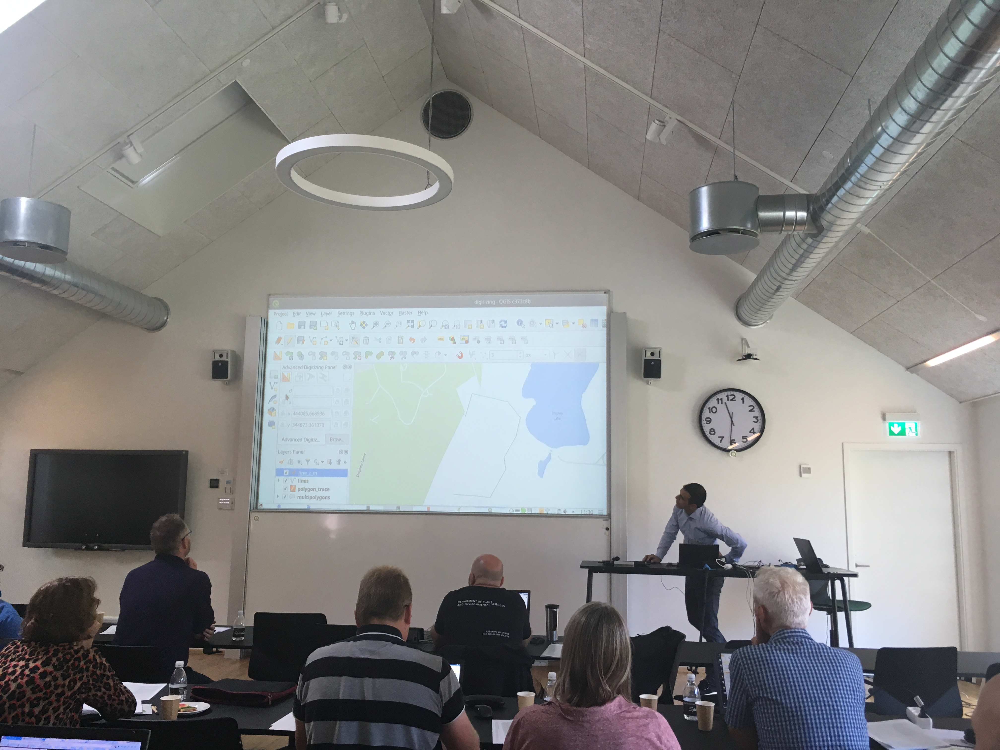</a>

<strong>QGIS Web Client &#8211; Version 2</strong>

Andreas Neumann showed of the new generation of QGIS Web Client (QWC2). The new web client is really nice &#8211; responsive design and takes advantage of open layers 3 including rotating maps, permalink for any map view / set of layers, map tools for measure, draw, export etc.

Future plans include improved redlining tools including text, polygons, user authentication via LDAP or oauth, support QGIS ‘drag and drop’ forms, clip and ship and a QGIS plugin for the configuration so you do not need to edit JSON files. Also thinking about supporting vector tiles for the base maps.

<a href="andreas.jpg">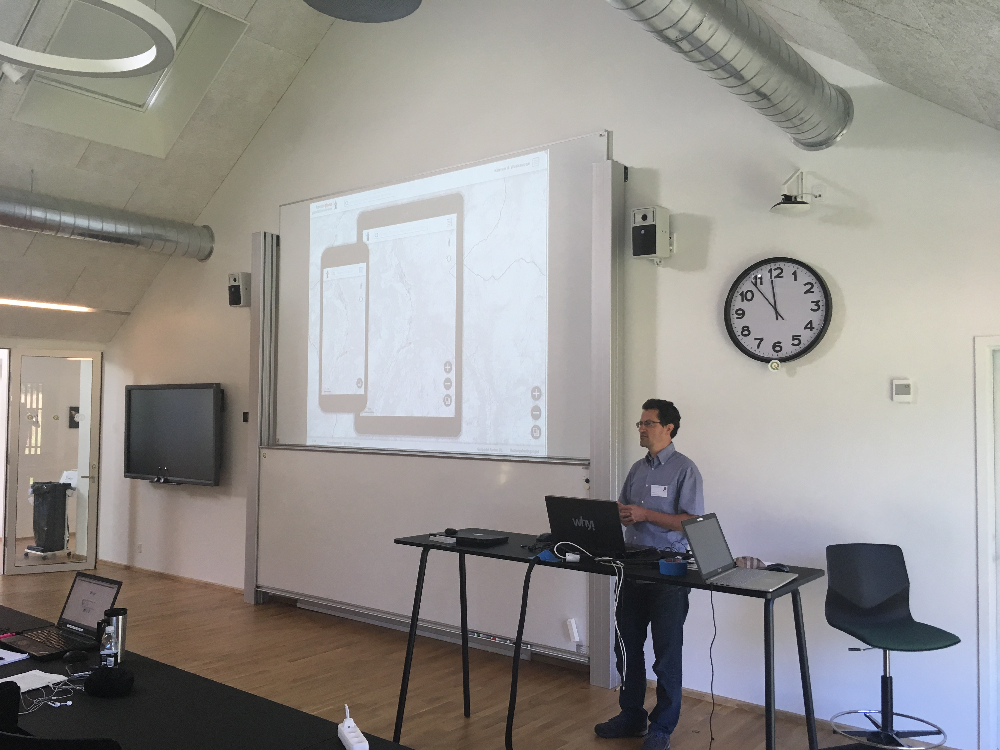</a>

<strong>I bet you didn&#8217;t know you could do this with QGIS</strong>

Nyall Dawson gave an awesome demo of the power and capabilities of QGIS&#8217; labelling, symbology and expression features. His demo took us through an adventure story where each scene in the story was rendered using QGIS (based on the upcoming version 3 release). This included animated clouds floating by, lightning effects, electrical effects, smoke effects and many more cool and interesting ideas that really showed off the power and versatility of QGIS.

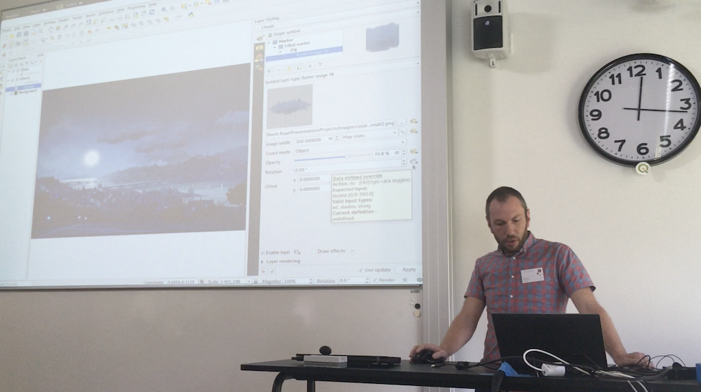

<strong>QGIS 3D</strong>

Martin Dobias (Lutra Consulting) gave a presentation on the <a href="http://blog.qgis.org/2017/04/30/qgis-grant-programme-2-results/">QGIS grant proposal</a>  work he has been doing to support 3D visualizations natively in QGIS 3.  His work leverages the new Qt 3D framework provided in Qt5 (the toolkit used to develop QGIS) and allows you to use an elevation model to model a 3D terrain and use a new tab in the vector style properties dock to extrude features out from the landscape. We have had a number of 3D  tools in QGIS in the paste but none has ever been a mainstream component of QGIS, enabled and ready to use &#8216;out of the box&#8217;. Expect Martin&#8217;s work to change that. There were many ideas passed around about how the 3D support in QGIS could be extended but the grant proposal only supports the first-pass implementation, so please do fund Martin&#8217;s work if you would like to see him add specific features in the future.

<a href="qgis-3d.png">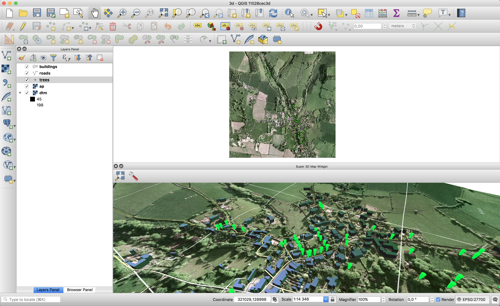</a>

<b> </b>

<b>QIGS as a cadastral management platform</b>

Prof. Erik Stubkjaer gave two presentations &#8211; one as a call for interest in those interested in building land parcel / cadastral management tools. He also gave an overview of the state of domain models for managing and recording property rights, including LADM (Land Administration Domain Model) and STDM (Standard Tenure Domain Model). He outlined that world aid organizations are increasingly putting an emphasis on enabling better tax revenue as a path to economic and social stability, and having a cadaster is a key element to the enablement. There are already a number of cadastral management tools out there for QGIS &#8211; it would be great to heed Prof. Stubkjaer&#8217;s clarion call and build a generic toolset for cadastral management in QGIS.

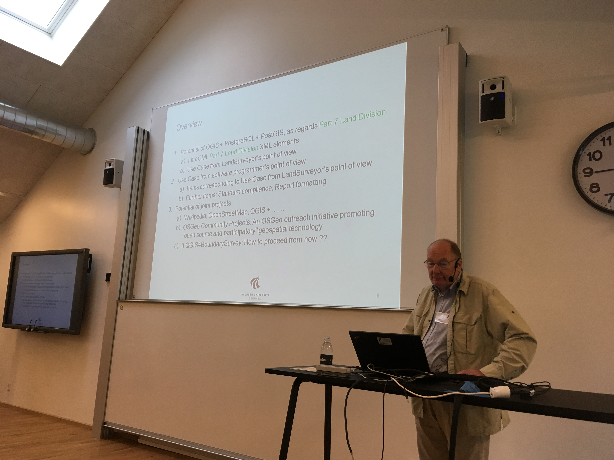

<strong>The future of coordinate reference system support in QGIS</strong>

Kristian Evers from the Danish Agency for Data Supply and Efficiency spoke about the use of Coordinate Reference Systems in QGIS and the use of WGS84. He pointed out the fact that there are 6 different versions of WGS84 and they vary by up to a meter. He also highlighted the issue that e.g. ETRS89 drifts more out of sync each year. In addition the earth is dynamic with plates shifting and different regions moving with different velocities. He showed a really nice video made in Australia highlighting the issue (see here: <a href="http://www.icsm.gov.au/gda2020/">http://www.icsm.gov.au/gda2020/</a> for details and the video). They use a plate fixed datum (which moves with the plates) together with a global datum (fixed to the center of the earth). This new approach is being planned / used in other places too (e.g. Iceland) and are called “dynamic datums”.  The dynamic datums will rely on a time stamp too as well as coordinates.

To address this they are introducing the concept of <b>transformation pipelines</b> in Proj.4 (the library used by QGIS to support projection) &#8211; there will be a new release of Project.4 which includes support for this.

<a href="kristian.jpg">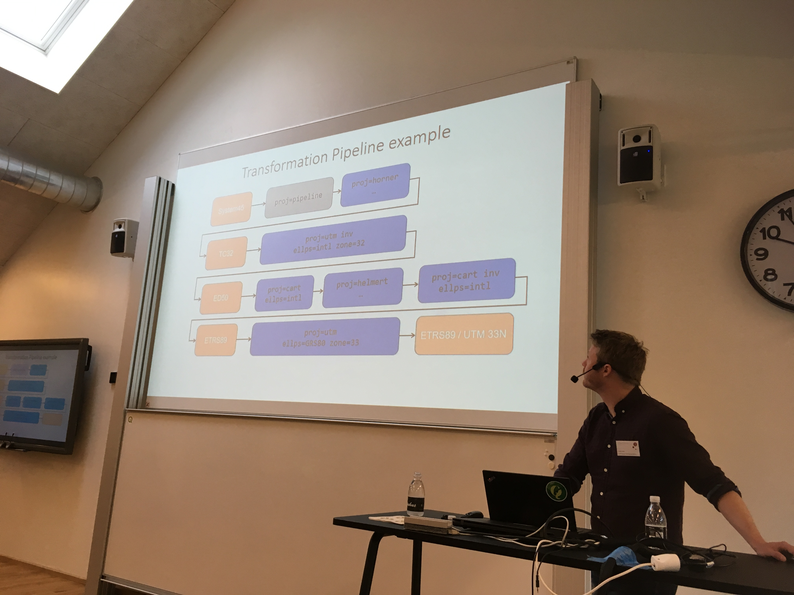</a>

<strong>InaSAFE</strong>

Tim Sutton (your humble blog post author) gave a presentation about <a href="http://inasafe.org">InaSAFE</a> &#8211; a plugin for QGIS that helps communities prepare for disasters.

<a href="inasafe-screenshot-lores-1.jpg">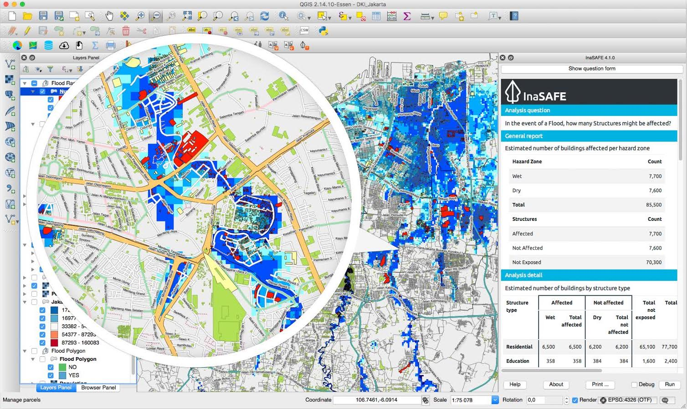</a><strong>Jonas van Schrojenstein Lantern (from Nelen &amp; Schuurmans)</strong>

Jonas&#8217; company built really fast and efficient models for flood models including 3D visualization. They have a really nice plugin for QGIS that lets you view a pipe model and different behaviors based on changed water levels. It requires a specific data model (d3i) in the Postgres backend and then you can visualize water levels in any pipe section. The plugin also lets you do the digitizing of the pipe network etc. The software also requires the use of som 3di services that Jonas will clarify how the licensing etc. should work.

<a href="jonas.jpg">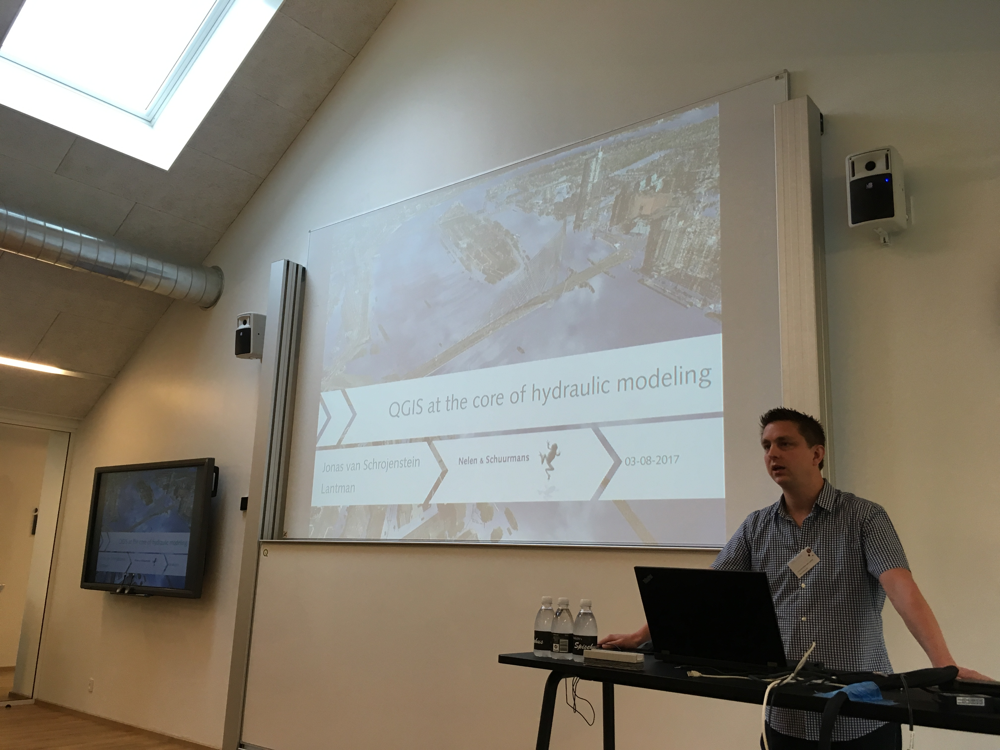</a>

<strong>Mie Winstrup &#8211; Septima &#8211; sometimes Open Source is just plain better</strong>

Mie shared a case study about how they used Open Source to replace a tool built with ArcMap + Model Builder for flood modeling. They used <b>malstroem</b>  &#8211; a python command line module and also integrated with QGIS. It assumes the terrain is an impermeable surface and that water flows from one cell to another. The tool models where water will accumulate in the landscape and what the depths are at each &#8216;blue spot&#8217;. It also models how much water will flow from the blue spots (based on modeled precipitation amount e.g. 100mm rain). It generates an event layer which shows how many cubic meters of water will spill over to the neighboring watershed.

<a href="mie2.jpg">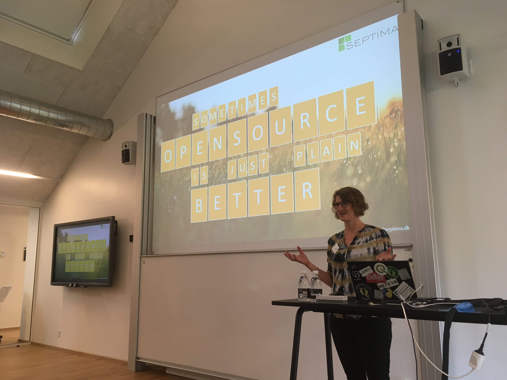</a>

<a href="mie3.jpg">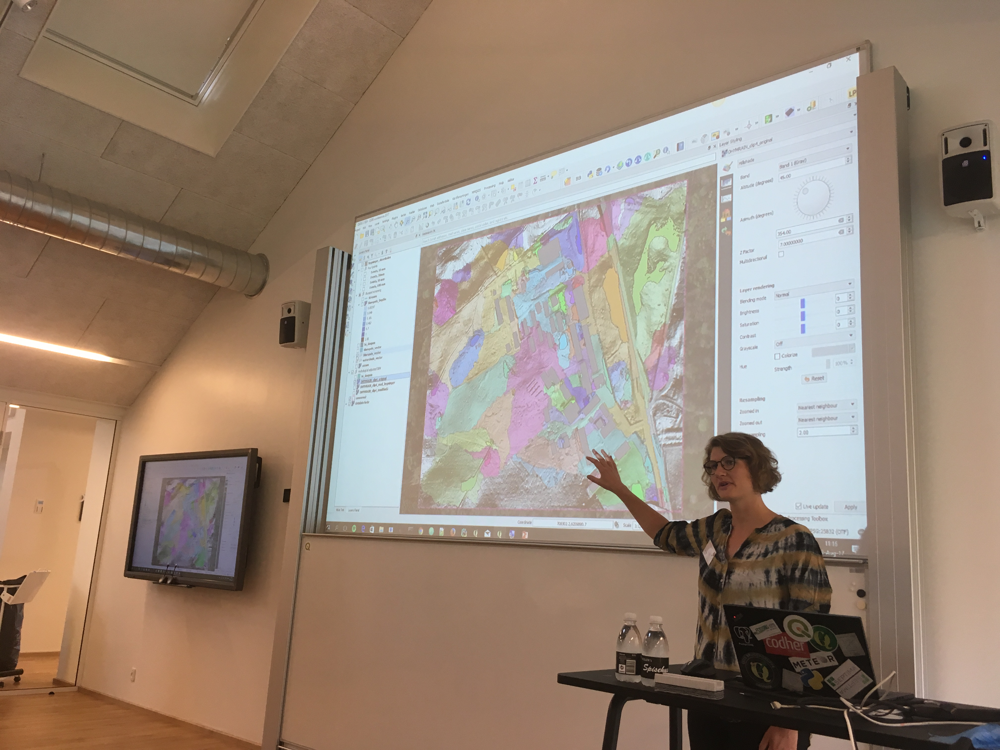</a>

<a href="https://github.com/Septima/qgis-malstroem">https://github.com/Septima/qgis-malstroem</a>

<strong>Saber Razmjooei &#8211; Lutra consulting &#8211; Crayfish plugin</strong>

Crayfish C++ plugin for QGIS adds a new renderer for gridded data. Works with HDF, NetCDF and GRIB.

<a href="crayfish.jpg">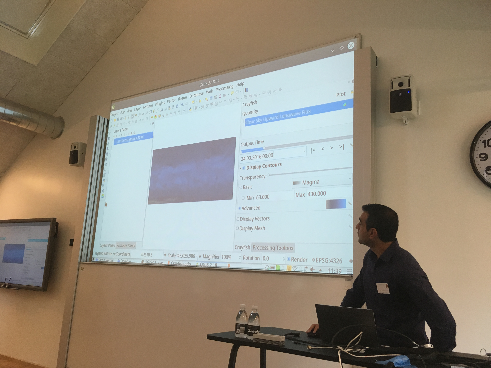</a>

<strong>What to watch out for in QGIS 3.</strong>

Nyall Dawson (core QGIS developer) gave a talk on what to expect in QGIS 3. The talk was not a feature round up but rather aimed at those concerned about the potential gotchas they will have to take care of when they migrate from QGIS 2 to QGIS 3 in their production environments. I record

&nbsp;

<iframe loading="lazy" class="has-ratio" width="640" height="360" src="https://www.youtube.com/embed/TcZd1Y_ISi4?version=3&#038;rel=1&#038;showsearch=0&#038;showinfo=1&#038;iv_load_policy=1&#038;fs=1&#038;hl=en&#038;autohide=2&#038;wmode=transparent" allowfullscreen="true" sandbox="allow-scripts allow-same-origin allow-popups allow-presentation allow-popups-to-escape-sandbox"></iframe>

<strong>Monica Balestrin Nunes &amp; Ana Paula Maciel (National Secretariat for Housing in the Ministry of Cities, Brazil)</strong>

Monica and Ann Paula presented a talk on how the Ministry of Cities in Brazil are using QGIS and mapping to manage the roll out of housing projects to support  provision of housing for the poor <b>“My House, My Life”</b>. The project aims to help 4.5 million people get into housing.  They used QGIS to develop a site selection process too. They used a simple process to map urban areas, developed versus undeveloped urban areas, schools. They also used public transport as a parameters to further constrain the available areas. These data were used to produce a synthesis map which shows high, medium and low suitability of areas for housing development. They used a digital coding system to classify each area (which can be mapped back to the high, medium and low assessment ratings). They also used GeoServer, GeoKettle, PostgreSQL/PostGIS.

<a href="monicanunes.jpg">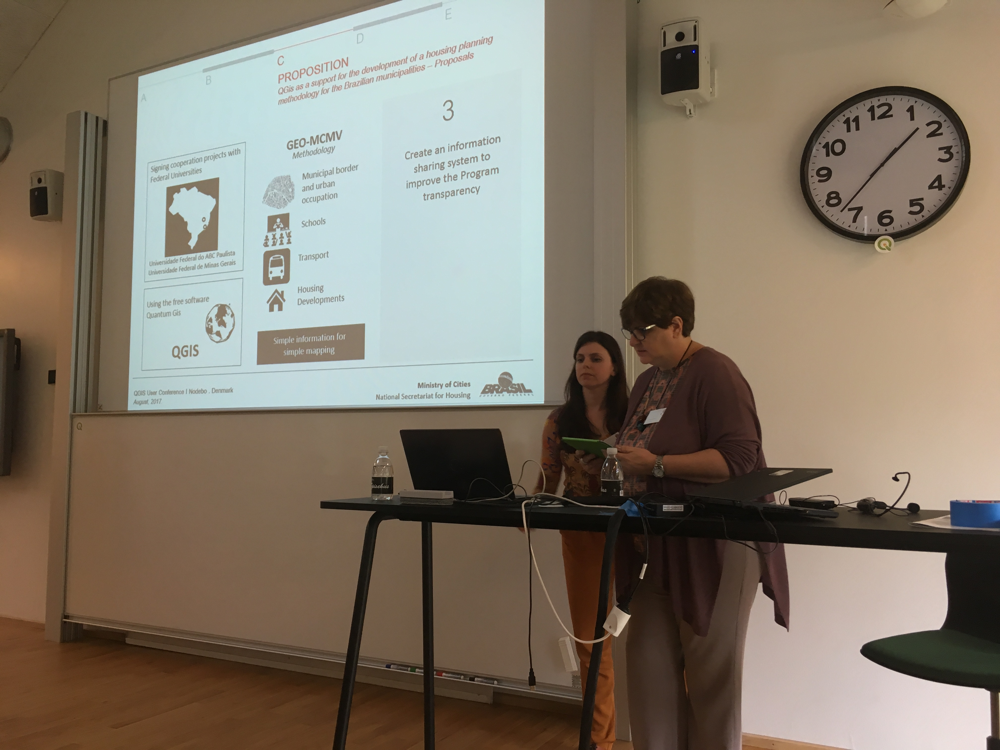</a>

<strong>Sophie Commelinck &#8211; University of Twente</strong>

Automated cadastral mapping using UAVs. Sophie showed workflows she is building for automatic extraction of parcel boundaries from UAV imagery. She showed some interesting work in doing boundary line detection using the SLIC algorithm which creates smoothed lines along boundaries. See <a href="http://github.com/scrommelinck/boundarylinedelineation">http://github.com/scrommelinck/boundarylinedelineation</a> for more details.

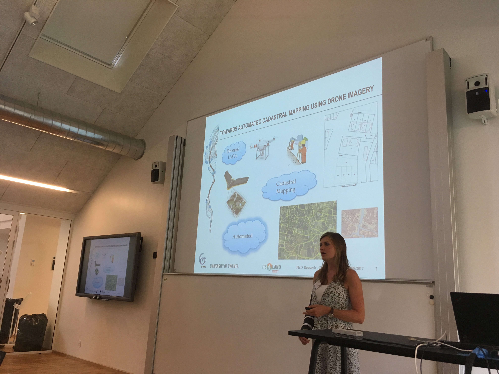

<strong>Kimberley Briscoe, Abingdon School, UK</strong>

Kimberley has been doing interesting things with high school kids learning GIS via QGIS. This work included using the time manager plugin to visualize global earthquakes and using r.lake.coordinates to do flood modeling. They also use ‘field trip gb’ mobile app to do field data collection. Many other plugins were used like EVIS, QGIS2Threejs. They also use interesting national datasets like crime etc. and data from <a href="http://data.gov.uk">http://data.gov.uk</a> for their classroom work.

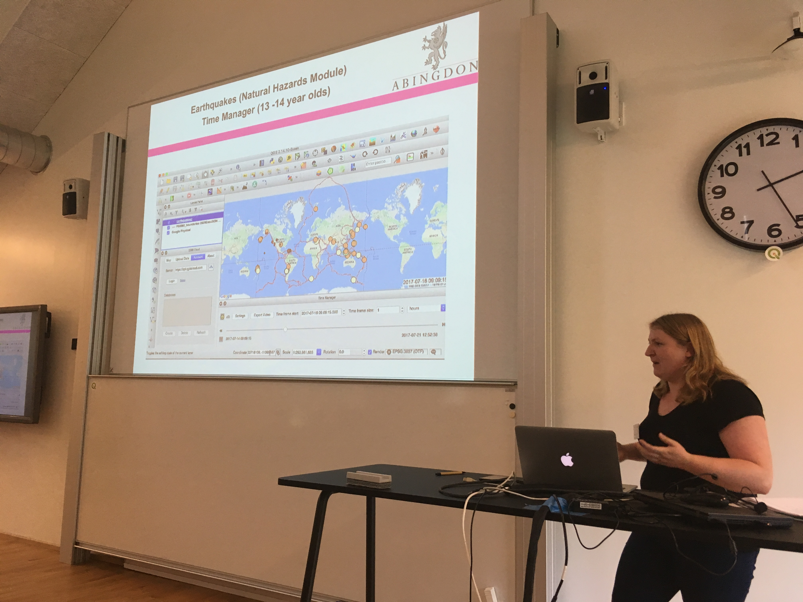

<strong>Badri Basnet &#8211; The University of Southern Queensland</strong>

Badri is a lecturer and has 90% online students in many different locations worldwide and with varying levels of internet access.  Badri has made many open content QGIS training videos and worksheets that he uses for his courses (which are based on QGIS). His videos are all on YouTube.

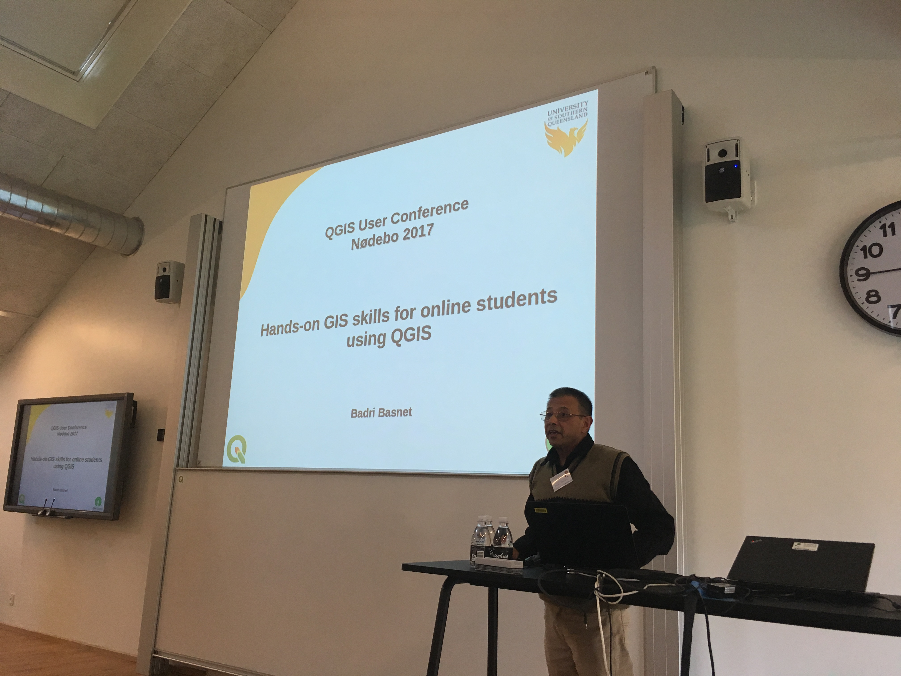

<strong>QField &#8211; Matthias Kuhn and Marco Bernasocchi (<a href="http://opengis.ch">opengis.ch</a>)</strong>

Matthias and Marco gave presentations on QField &#8211; an Android field data collection app based on QGIS (but with a mobile centric user interface). Matthias showed us many of the cool features QField has, whilst Marco outlined strategies for integrating field work, web publishing and desktop GIS work in a seamless workflow. I made some videos with my phone &#8211; audio and video quality is not brilliant but should be enough to follow along for those interested:

<iframe loading="lazy" class="has-ratio" width="640" height="360" src="https://www.youtube.com/embed/WevRTiLe7ts?version=3&#038;rel=1&#038;showsearch=0&#038;showinfo=1&#038;iv_load_policy=1&#038;fs=1&#038;hl=en&#038;autohide=2&#038;wmode=transparent" allowfullscreen="true" sandbox="allow-scripts allow-same-origin allow-popups allow-presentation allow-popups-to-escape-sandbox"></iframe>

<iframe loading="lazy" class="has-ratio" width="640" height="360" src="https://www.youtube.com/embed/pTFzmg2WaVg?version=3&#038;rel=1&#038;showsearch=0&#038;showinfo=1&#038;iv_load_policy=1&#038;fs=1&#038;hl=en&#038;autohide=2&#038;wmode=transparent" allowfullscreen="true" sandbox="allow-scripts allow-same-origin allow-popups allow-presentation allow-popups-to-escape-sandbox"></iframe>

<strong>Lene Fischer (Skovskolen)</strong>

Lene (who also happens to be the event organizer &#8211; hurrah for the great job she did along with her team of volunteers!) showed how they approach teaching GIS and QGIS using ‘flipped learning’ where users first need to self study content on their own, and then use the lecturer as a consultant.

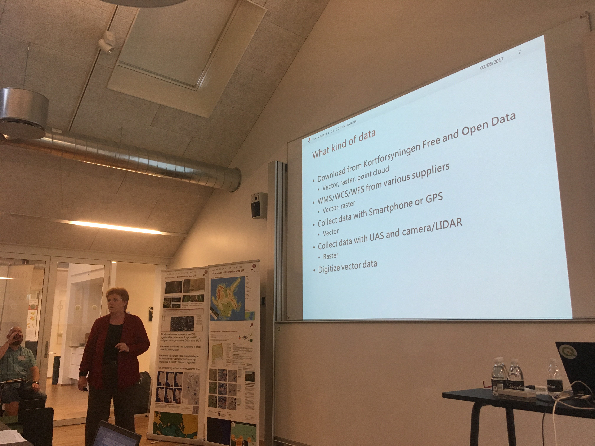

<strong>Tim Sutton &#8211; Cadasta</strong>

Your trusty author again &#8211; I presented work we have been doing to support mapping land rights of people in developing nations using the Standard Tenure Domain Model style approach where tenure is treated as a continuum rather than an absolute. You can find out more about this project at <a href="http://cadasta.org">Cadasta.org</a>

<h2>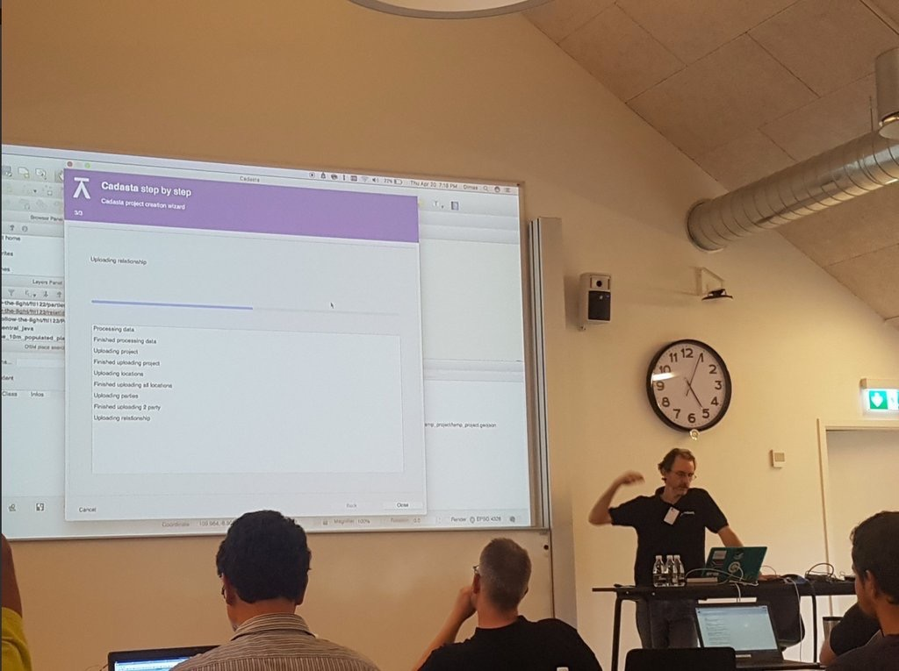</h2>
<h2>Workshops</h2>

The event was also filled with great workshops &#8211; two during the main conference, and then a week of post conference workshops. Most of the workshops were presented by developers or QGIS project members and represented a fantastic opportunity for attendees to learn straight from the experts!

<h2></h2>
<h2>Town hall meeting</h2>

At the end of the user conference, we held a town hall meeting where developers and active QGIS community members fielded a range of questions from the audience. It is always a please to hold these sessions &#8211; we get a direct channel of communication with our users and they get to speak directly to the people making the software they use and find out why we make the choices we make!

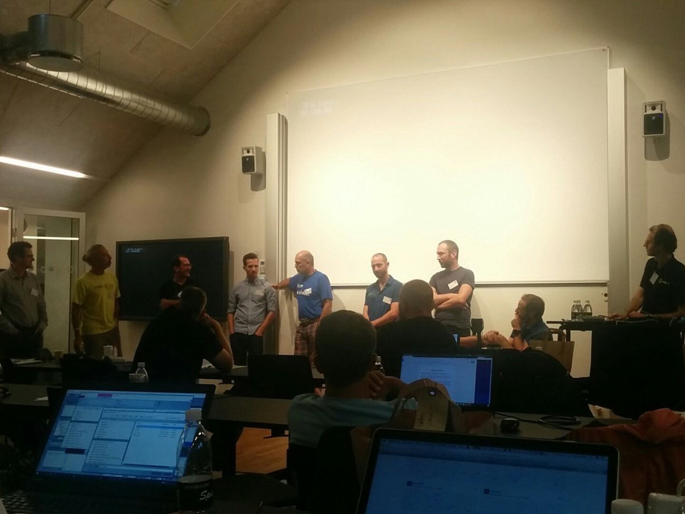

<h2></h2>
<h2><strong>Hackfest</strong></h2>

The &#8220;hackfest&#8221; (developer meeting &#8211; we use &#8216;hack&#8217; in the positive sense of the word) was a chance for the QGIS community members to roll up their sleeves and work on new features, bug fixes, documentation and general polish of QGIS and related resources. It is always great to be able to work side by side for a few days &#8211; compared to our very geographically dispersed nature over the rest of the year. It was especially nice this event that many developers brought their families along to enjoy the beautiful scenery and great facilities at the Skovskolen. Here is a group photo taken by Mary Anne Lister:

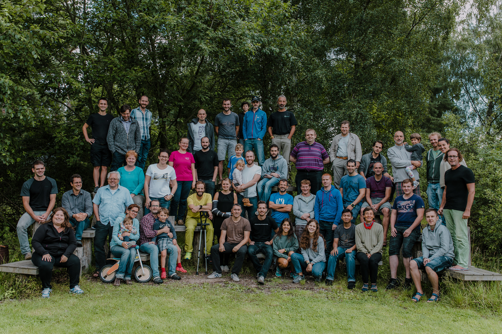

<h2>Thanks</h2>

On behalf of the whole QGIS community, I would like to extend our heartfelt thanks to Lene Fischer (event organizer), her team of volunteers, all the attendees who took the time to attend the conference &#8211; and of course all the developers and QGIS Community Members who attended and made it such a great event!

&nbsp;

<h2>Event sponsor links:</h2>
<ul>
<li><strong>University of </strong><strong><a href="http://www.ku.dk/english" target="_blank" rel="noopener">Copenhagen</a> (</strong>Host).</li>
<li><strong><a href="http://qgis.dk/" target="_blank" rel="noopener">QGIS Usergroup Denmark</a></strong></li>
<li><a href="http://osgeo.org/" target="_blank" rel="noopener">Open Source Geospatial Foundation 
</a></li>
<li><a href="http://www.lutraconsulting.co.uk/" target="_blank" rel="noopener">Lutra Consulting</a></li>
<li><a href="http://www.artogis.dk/" target="_blank" rel="noopener">ArtoGIS</a></li>
<li><a href="http://www.cowi.dk/" target="_blank" rel="noopener">COWI</a></li>
<li><a href="http://www.septima.dk/" target="_blank" rel="noopener">Septima</a></li>
<li> <a href="http://www.sungis.lv/" target="_blank" rel="noopener">SunGIS</a></li>
<li><a href="http://www.sungis.lv/" target="_blank" rel="noopener">BoundlessGeo</a></li>
</ul>

&nbsp;

&nbsp;

