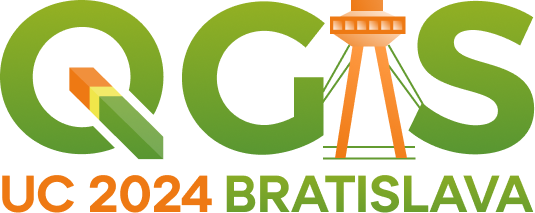

We are happy to announce that QGIS User Conference will take place on 9-10 September 2024 in Bratislava, Slovakia.

<figure></figure>

 The traditional Contributor Meeting will be held right after the conference on 11-13 September 2024 at the same venue.  Learn more about the user conference and the contributor meeting at the event&#8217;s web site: <a href="https://uc2024.qgis.sk/" rel="nofollow">https://uc2024.qgis.sk/</a>  The call for papers for the user conference is now open &#8211; you can <strong>submit</strong> <strong>proposals for talks and workshops by 31 March 2024:</strong> <a href="https://uc2024.qgis.sk/call-for-papers/" rel="nofollow">https://uc2024.qgis.sk/call-for-papers/</a>  We have also started call for sponsors, with <strong>sponsorship opportunities</strong> at various levels. More details here: <a href="https://uc2024.qgis.sk/sponsors/" rel="nofollow">https://uc2024.qgis.sk/sponsors/</a>  <strong>User Conference</strong>  The QGIS User Conference is an annual event that brings together users and developers of QGIS. The conference provides an opportunity for attendees to learn about the latest developments in QGIS, share their experiences with others, and network with other QGIS users and developers.  <strong>Contributor Meeting</strong>  QGIS Contributor Meetings are volunteer-driven events where contributors to the QGIS project from around the world get together in a common space – usually a university campus. During these events, contributors to the QGIS project take the opportunity to plan their work, hold face-to-face discussions and present new improvements to the QGIS project that they have been working on. Everybody attending the event donates their time to the project for the days of the event. As a project that is built primarily through online collaboration, these meetings provide a crucial ingredient to the future development of the QGIS project. The event is planned largely as an ‘unconference’ with minimal structured programme planning.

For more details and to sign up, please visit the corresponding wiki page <a href="https://github.com/qgis/QGIS/wiki/27th%E2%80%90Contributor%E2%80%90Meeting%E2%80%90in%E2%80%90Bratislava" rel="nofollow">https://github.com/qgis/QGIS/wiki/27th%E2%80%90Contributor%E2%80%90Meeting%E2%80%90in%E2%80%90Bratislava</a>

