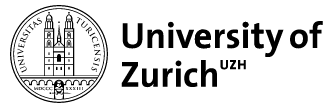

<strong>An amazing 30 new sustaining members have already answered <a href="https://blog.qgis.org/2023/01/16/crowd-funding-call-2023/">our crowd-funding call</a></strong> <strong>raising total member contributions to €158,000 annually. </strong>

We are particularly happy to welcome our first medium-level university sustaining member, the University of Zurich, Department of Geography:

<strong>New medium sustaining members</strong>

<figure><figcaption>Institut Dr. Nowak GmbH, Germany</figcaption></figure>

<figure><figcaption>Bohannan Huston, New Mexico, USA</figcaption></figure>

<figure><figcaption>University of Zurich, Department of Geography</figcaption></figure>

<figure><figcaption>Idrostudi srl, Italy</figcaption></figure>

<strong>New small sustaining members</strong>

<ul>
<li>Pacific Geomatics Limited, Canada</li>

<li>Helix Resources Limited, Australia</li>

<li>Sand Hill Geographic, Virginia, United States</li>

<li>GIS Pro Western Australia</li>

<li>The Spatial Distillery Company, Victoria, Australia</li>

<li>Qwast-GIS, The Netherlands</li>

<li>CEICOL, Colombia</li>

<li>QGIS user group Norway</li>

<li>Robex resources, Quebec, Canada</li>

<li>analyGIS GmbH, Switzerland</li>

<li>CartoExpert, France</li>

<li>addresscloud, UK</li>

<li>Baugeologie und Geo-Bau-Labor AG, Switzerland</li>

<li>Spatial Thoughts, India</li>

<li>Centremaps, UK</li>

<li>Geoideal, Colombia</li>

<li>theworksLA, California, United States</li>

<li>SoftWater s.r.l., Italy</li>

<li>menz umweltplanung,Germany</li>

<li>Oy Arbonaut Ltd, Finland</li>

<li>ZevRoss Spatial Analysis, New York, United States</li>

<li>Ecophylla Consulting, Ontario, Canada</li>

<li>DeBeer&amp;DeVos BV, Belgium</li>

<li>Reuther NetConsulting, Germany</li>

<li>H13, Denmark</li>

<li>Rockwater Pty Ltd, Australia</li>
</ul>

Even with this impressive list of new members, we also realize that we have not reached the campaign goals yet and that potential large and flagship members may need more time to respond.

<strong>Our funding progress so far: </strong>

<figure></figure>

Therefore, we are extending the campaign until the end of March 2023.

<strong>Become a <a href="https://qgis.org/en/site/getinvolved/governance/sustaining_members/management.html">sustaining member</a> or <a href="https://donate.qgis.org">donor</a>. Every contribution counts.</strong>

Details: <a href="https://qgis.org/en/site/getinvolved/governance/sustaining_members/sustaining_members.html">Sustaining Membership Program Overview</a>

