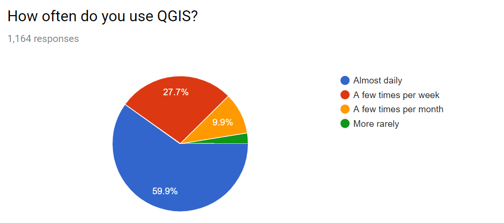
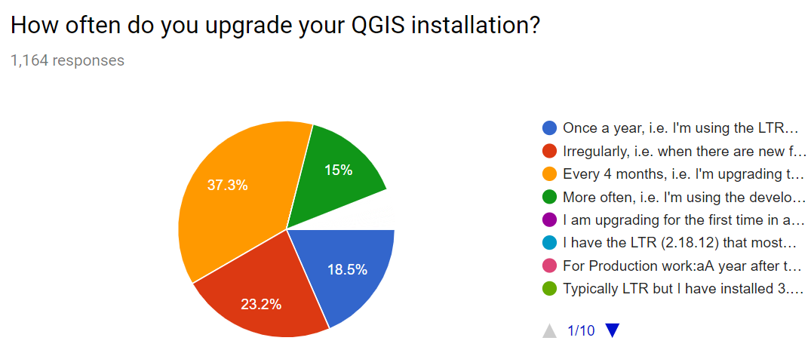
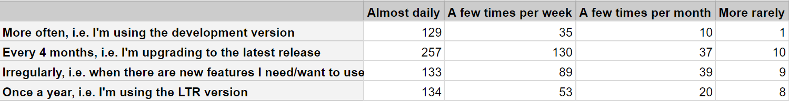

It&#8217;s December and that means it is time to plan for the next year. Planning also means preparing a budget and to do so, we would like to learn more about what you think QGIS.ORG should focus on: features or bug fixing and polishing? Therefore, we invite you to our <a href="https://docs.google.com/forms/d/e/1FAIpQLScj0ibxG2hsUSKsvidC6-lCWPnA5icvtA_fT08Jg80aNonncw/viewform?usp=sf_link">QGIS user question of December 2018</a>.

We also have localized translated versions of this questionnaire for our <a href="https://framaforms.org/qgis-utilisateurs-la-question-du-mois-122018-1543901215">French-speaking </a>and <a href="https://docs.google.com/forms/d/e/1FAIpQLSeCZddJ7AuUWJGlwgma9VjLg46Syin3sOAZS82SEaMnY-9HfA/viewform">Portuguese-speaking</a> users.

<h3>Your answers in November</h3>

In November, we wanted to know which version of QGIS you use.

