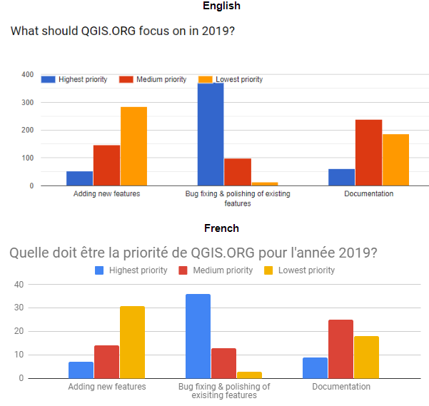
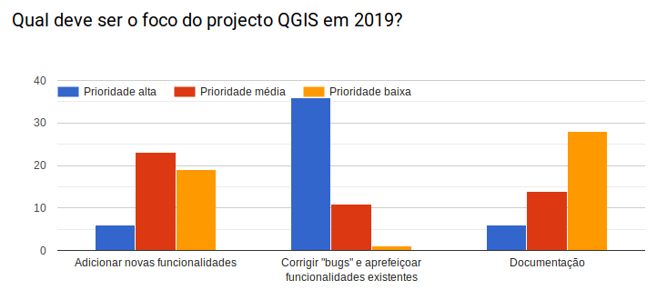

In December, we wanted to know what QGIS.ORG should focus on in 2019.

<strong>Portuguese </strong>

Based on these results, in today&#8217;s PSC meeting, we&#8217;ve decided that the 2019 grant programme will be focusing on bug fixing and polishing existing features. So thanks to everyone who provided feedback!

<h3>New question</h3>

This month, we&#8217;d like to know if you have ever contributed to improving QGIS and &#8211; if yes &#8211; how. As you&#8217;ll see, there are many different ways to contribute to QGIS, so please go ahead and <a href="https://ee.kobotoolbox.org/x/#CSL7n2HR">take the survey</a>.

The survey is available in English, Spanish, Portuguese, French, Italian, Ukrainian, and Danish. If you want to help us translate user questions in more languages, please get in touch!

